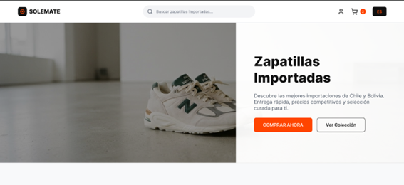
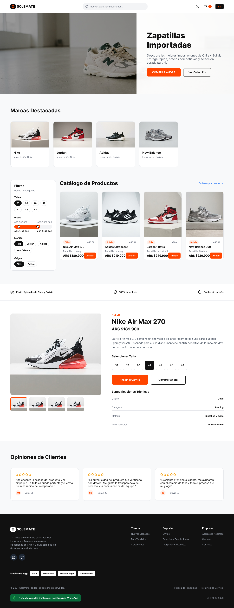
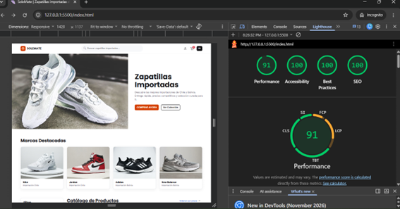

# SoleMate – Ecommerce de zapatillas importadas

Maquetación front-end de **SoleMate**, una tienda online de zapatillas importadas de Chile y Bolivia (Nike, Jordan, Adidas y New Balance). Proyecto realizado para el **TP N° 3 de Programación Web**: _Repaso Front-End (Bootstrap vs. Tailwind) & Git Workflow. SEO. Accesibilidad. HTML Semántico_.

## Enlaces

- **Sitio publicado:** https://albarorodo1234-oss.github.io/ecommerce-zapatillas/
- **Repositorio:** https://github.com/albarorodo1234-oss/ecommerce-zapatillas
- **Informe de auditoría Lighthouse:** [docs/auditoria-lighthouse.md](docs/auditoria-lighthouse.md)

## Vistas del sitio

Las 10 vistas se maquetaron en HTML5 semántico a partir del diseño hecho en Figma.

| #   | Vista                | Archivo                                                                                        |
| --- | -------------------- | ---------------------------------------------------------------------------------------------- |
| 1   | Inicio               | [index.html](https://albarorodo1234-oss.github.io/ecommerce-zapatillas/index.html)             |
| 2   | Catálogo con filtros | [catalogo.html](https://albarorodo1234-oss.github.io/ecommerce-zapatillas/catalogo.html)       |
| 3   | Detalle de producto  | [producto.html](https://albarorodo1234-oss.github.io/ecommerce-zapatillas/producto.html)       |
| 4   | Carrito              | [carrito.html](https://albarorodo1234-oss.github.io/ecommerce-zapatillas/carrito.html)         |
| 5   | Inicio de sesión     | [login.html](https://albarorodo1234-oss.github.io/ecommerce-zapatillas/login.html)             |
| 6   | Registro             | [registro.html](https://albarorodo1234-oss.github.io/ecommerce-zapatillas/registro.html)       |
| 7   | Guía de tallas       | [guia-tallas.html](https://albarorodo1234-oss.github.io/ecommerce-zapatillas/guia-tallas.html) |
| 8   | Checkout             | [checkout.html](https://albarorodo1234-oss.github.io/ecommerce-zapatillas/checkout.html)       |
| 9   | Contacto             | [contacto.html](https://albarorodo1234-oss.github.io/ecommerce-zapatillas/contacto.html)       |
| 10  | Nosotros             | [nosotros.html](https://albarorodo1234-oss.github.io/ecommerce-zapatillas/nosotros.html)       |

## Diseño en Figma





### Paleta y tipografías

| Uso                     | Color     |
| ----------------------- | --------- |
| Naranja vivo (detalles) | `#FF4D00` |
| Naranja de botones      | `#D43F00` |
| Rojo (contador)         | `#D62839` |
| Amarillo (estrellas)    | `#FFB400` |
| Oscuro (footer)         | `#111114` |
| Fondo suave             | `#F7F8FA` |

- **Títulos:** Poppins
- **Textos:** Inter

El naranja del diseño original (`#FF4D00`) no alcanza el contraste mínimo de 4,5:1 con texto blanco, por lo que en botones se usa `#D43F00`, casi idéntico a la vista y accesible.

## Tecnologías

- HTML5 semántico
- CSS3 con variables personalizadas
- [Bootstrap 5.3.3](https://getbootstrap.com/) y [Bootstrap Icons 1.11.3](https://icons.getbootstrap.com/)
- Google Fonts (Poppins e Inter)
- Prettier (formateo de código)
- Lighthouse (auditoría de accesibilidad, buenas prácticas y SEO)
- Git, GitHub y GitHub Pages
- VSCode con Live Server y Figma (diseño)

## Estructura del proyecto

```
ecommerce-zapatillas/
├── css/
│   └── styles.css
├── js/
│   └── main.js
├── img/                      # fotografías de productos y hero
├── docs/
│   ├── auditoria-lighthouse.md
│   ├── diseno/               # capturas del diseño de Figma
│   └── lighthouse/           # capturas de la auditoría
├── .vscode/settings.json     # formateo con Prettier al guardar
├── .prettierrc
├── .prettierignore
├── index.html
├── catalogo.html
├── producto.html
├── carrito.html
├── login.html
├── registro.html
├── guia-tallas.html
├── checkout.html
├── contacto.html
├── nosotros.html
└── README.md
```

## Cómo ejecutarlo localmente

1. Clonar el repositorio:

   ```bash
   git clone https://github.com/albarorodo1234-oss/ecommerce-zapatillas.git
   cd ecommerce-zapatillas
   ```

2. Abrir `index.html` con la extensión **Live Server** de VSCode (clic derecho → _Open with Live Server_) o directamente en el navegador.

3. (Opcional) Instalar Prettier y verificar el formato:

   ```bash
   npm install
   npx prettier . --check
   ```

## Flujo de trabajo con Git

El proyecto se desarrolló con un flujo basado en ramas y Pull Request:

1. Se creó el repositorio y la estructura base (`css/`, `js/`, `img/`) sobre la rama `main`.
2. Se creó la rama de trabajo `feature/maquetacion`.
3. Se maquetaron las 10 vistas con commits frecuentes, uno por vista o bloque lógico.
4. Se formateó el código con Prettier y se auditó con Lighthouse.
5. Se subió la rama a GitHub y se abrió un Pull Request hacia `main`.
6. Se revisó y se fusionó (merge) el Pull Request.
7. Se desplegó el sitio en GitHub Pages desde la rama `main`.

Los mensajes de commit siguen una convención de prefijos:

| Prefijo  | Uso                         |
| -------- | --------------------------- |
| `feat:`  | Funcionalidad o vista nueva |
| `fix:`   | Corrección                  |
| `style:` | Formato de código           |
| `docs:`  | Documentación               |
| `chore:` | Tareas de configuración     |

## HTML semántico, SEO y accesibilidad

- Estructura con `header`, `nav`, `main`, `section`, `article`, `aside` y `footer`.
- Un solo `<h1>` por página y títulos en orden jerárquico.
- `<title>` y `meta description` propios en cada vista, con `<html lang="es">`.
- Texto alternativo (`alt`) descriptivo en las imágenes; vacío en las decorativas.
- Todos los campos de formulario con `<label>` asociado; opciones agrupadas con `<fieldset>` y `<legend>`.
- Enlace "Saltar al contenido" y estilos de foco visibles para navegar con teclado.
- `aria-label` en íconos enlazados y botones sin texto visible.
- Contraste de color de al menos 4,5:1 en los textos.
- Respeto de `prefers-reduced-motion`.
- Diseño responsive con la grilla de Bootstrap.
- Rutas relativas y nombres de archivo en minúsculas para que funcione en GitHub Pages.

## Auditoría Lighthouse

Resultado de la home (modo móvil, Lighthouse 13.5.0):

| Performance | Accessibility | Best Practices | SEO |
| ----------- | ------------- | -------------- | --- |
| 91          | 100           | 100            | 100 |



El detalle de las páginas auditadas, las medidas de accesibilidad aplicadas y las mejoras de rendimiento pendientes están en [docs/auditoria-lighthouse.md](docs/auditoria-lighthouse.md).

## Bootstrap vs. Tailwind CSS

| Criterio                 | Bootstrap                                                           | Tailwind CSS                                                                 |
| ------------------------ | ------------------------------------------------------------------- | ---------------------------------------------------------------------------- |
| Enfoque                  | Framework de **componentes** ya armados (navbar, card, botones)     | Framework de **utilidades**: clases pequeñas (`flex`, `p-4`) que se combinan |
| Curva de aprendizaje     | Baja: se copian y adaptan componentes                               | Media: hay que aprender su vocabulario de utilidades                         |
| Velocidad de prototipado | Muy rápida                                                          | Rápida una vez que se domina; más trabajo manual                             |
| Personalización          | Se sobrescribe con CSS propio; los sitios pueden parecerse entre sí | Diseño a medida desde cero, con más libertad                                 |
| HTML resultante          | Pocas clases por elemento (`btn btn-primary`)                       | Muchas clases por elemento                                                   |
| Peso del CSS             | Se carga el framework completo aunque se use una parte              | Genera solo las clases que se usan                                           |
| JavaScript               | Incluye componentes interactivos (modal, menú desplegable)          | No incluye JavaScript propio                                                 |
| Configuración            | Basta un `<link>` por CDN                                           | Requiere una herramienta de compilación para producción                      |

### Por qué se eligió Bootstrap

- Permitió maquetar **10 vistas** en poco tiempo gracias a su grilla (`row`, `col-*`) y a componentes listos: `card`, `breadcrumb`, `form-control`, `form-select`, `btn-check`, `table-responsive`.
- Tiene una curva de aprendizaje baja, ideal para un primer proyecto completo.
- Se integra con un solo `<link>`, sin herramientas de compilación.
- Los estilos propios (`css/styles.css`) se cargan después de Bootstrap y le dan al sitio una identidad visual propia (paleta, tipografías y componentes personalizados).

### Cuándo se elegiría Tailwind

Para un proyecto con un diseño muy particular, que no se parezca a ningún framework, o cuando se quiere un control fino del CSS y un resultado final más liviano.

## Mejoras futuras

- Hacer funcional el sitio con JavaScript: carrito, filtros y ordenamiento de productos.
- Conectar con un back-end y una base de datos para productos, usuarios y pedidos.
- Optimizar el peso de las imágenes para mejorar el rendimiento.
- Crear las páginas pendientes del footer (envíos, cambios y devoluciones, preguntas frecuentes).

## Autor

**Albaro Rodo**
Tecnicatura Superior en Análisis, Diseño y Desarrollo de Software – IES N° 6001, Salta, Argentina
Materia: Programación Web – TP N° 3
