# SoleMate – Ecommerce de zapatillas importadas

Sitio web de **SoleMate**, una tienda online de zapatillas importadas de Chile y Bolivia (Nike, Jordan, Adidas y New Balance). Proyecto de la materia **Programación Web**, desarrollado en seis etapas:

- **TP N° 3:** maquetación front-end en HTML5 semántico, CSS3 y Bootstrap, con Git Workflow, SEO y accesibilidad.
- **TP N° 4:** _Migración a PHP, Modularización (SSI) y Renderizado Server-Side (SSR)_. Las 10 vistas pasaron de HTML estático a PHP, con plantillas reutilizables, título y menú dinámicos, y variables de entorno.
- **TP N° 5:** _Procesamiento de formularios y seguridad web_. Formulario de contacto por POST y buscador con filtros del catálogo por GET, con sanitización, validación en el servidor, mensajes al usuario y prevención de XSS. Todo el desarrollo está en la carpeta [`clase5/`](clase5/).
- **TP N° 6:** _Diseño y creación del esquema relacional en MySQL_. Base de datos `solemate_db` normalizada hasta la 3FN, con su script de creación (`schema.sql`) y consultas de prueba CRUD (`consultas.sql`). Todo el desarrollo está en la carpeta [`tp6/`](tp6/).
- **TP N° 7:** _Persistencia y conexión PHP-MySQL segura_. El sitio se conecta a `solemate_db` con PDO: panel de administración con el CRUD de productos (carpeta [`admin/`](admin/)) y catálogo y detalle de producto leídos de la base, con consultas preparadas y protección XSS. Se desarrolló en la aplicación principal.
- **TP N° 8:** _Manejo de estado, sesiones y autenticación_. Registro, inicio y cierre de sesión con sesiones de PHP y contraseñas cifradas con bcrypt, guardián de rutas y control de acceso por rol: el panel `admin/` solo lo usa el Administrador. Se desarrolló en la aplicación principal.

## Enlaces

- **Repositorio:** https://github.com/albarorodo1234-oss/ecommerce-zapatillas
- **Prototipo en Figma:** [Ver el prototipo](https://www.figma.com/proto/jUfOsxLjA2Qn9kg3WJqB8j/Ecomerce-Zapatillas?node-id=2-3&p=f&t=eQLWJaIzpomdRZIH-1&scaling=scale-down-width&content-scaling=fixed&page-id=0%3A1)
- **Informe de auditoría Lighthouse (TP N° 3):** [docs/auditoria-lighthouse.md](docs/auditoria-lighthouse.md)
- **Desarrollo del TP N° 5:** [carpeta clase5/](clase5/) · [sección del README](#clase-5-procesamiento-de-formularios-y-seguridad-web-tp-n-5)
- **Desarrollo del TP N° 6:** [carpeta tp6/](tp6/) · [normalización](tp6/NORMALIZACION.md) · [sección del README](#clase-6-diseño-y-creación-del-esquema-relacional-en-mysql-tp-n-6)
- **Desarrollo del TP N° 7:** [conexión](config/conexion.php) · [panel admin/](admin/) · [sección del README](#clase-7-persistencia-y-conexión-php-mysql-segura-tp-n-7)
- **Desarrollo del TP N° 8:** [guardián de rutas](includes/auth_guard.php) · [login](login.php) · [registro](registro.php) · [sección del README](#clase-8-manejo-de-estado-sesiones-y-autenticación-tp-n-8)

> **Nota sobre la publicación:** en el TP N° 3 el sitio era HTML estático y se publicaba en GitHub Pages. Desde el TP N° 4 las vistas son `.php` y necesitan un servidor con PHP, que GitHub Pages no ofrece. Por eso el sitio se ejecuta en local con XAMPP (ver [Cómo ejecutarlo localmente](#cómo-ejecutarlo-localmente)).

## Refactorización a PHP (TP N° 4)

| Requisito                | Cómo se resolvió                                                                                                                                                                                                         |
| ------------------------ | ------------------------------------------------------------------------------------------------------------------------------------------------------------------------------------------------------------------------ |
| **Migración a PHP**      | Las 10 vistas `.html` se renombraron a `.php` con `git mv` (se conserva el historial) y se actualizaron todos los enlaces internos.                                                                                      |
| **Modularización (SSI)** | El código repetido se extrajo a `includes/`: `header.php` (`<head>`, metadatos y estilos), `nav.php` (barra superior y menú principal) y `footer.php` (pie de página y scripts). Cada vista los trae con `require_once`. |
| **SSR básico**           | Cada vista define `$titulo_pagina`, `$descripcion_pagina` y `$pagina_activa` antes de incluir el encabezado. El servidor arma el `<title>`, la descripción y la clase `active` del menú.                                 |
| **Variables de entorno** | El archivo `.env` (ignorado por Git) guarda `APP_NAME`, `APP_EMAIL` y `APP_ENV`. `config/env.php` las lee y las convierte en constantes. El repositorio incluye `.env.example` como plantilla.                           |
| **Seguridad (XSS)**      | Los datos que se imprimen se escapan con `htmlspecialchars()`. Por ejemplo, el término buscado en el catálogo.                                                                                                           |

### Cómo queda cada vista

```php
<?php
$titulo_pagina      = "Catálogo de zapatillas importadas | SoleMate";
$descripcion_pagina = "Explorá el catálogo de SoleMate: ...";
$pagina_activa      = "catalogo";
require_once 'includes/header.php';   // <head> + barra superior + menú
?>

<main id="contenido">
  <!-- contenido propio de la vista -->
</main>

<?php require_once 'includes/footer.php'; ?>
```

### Plantillas (`includes/`)

| Archivo               | Contenido                                                                              |
| --------------------- | -------------------------------------------------------------------------------------- |
| `includes/header.php` | Carga `config/env.php`, abre el HTML y el `<head>` y llama a `nav.php`                 |
| `includes/nav.php`    | Logo, buscador, accesos de cuenta y carrito, y el menú principal con la clase `active` |
| `includes/footer.php` | Pie de página, script `js/main.js` y cierre de `</body></html>`                        |

### Variables de entorno

`.env.example` (se sube al repositorio) muestra qué datos hay que configurar:

```
APP_NAME=Nombre de la tienda
APP_EMAIL=correo@ejemplo.com
APP_ENV=local
```

Para usarlas, se copia como `.env` y se completan los valores. El archivo `.env` real está en el `.gitignore` y **no se versiona**.

## Vistas del sitio

Las 10 vistas se maquetaron a partir del diseño hecho en Figma. La última columna indica qué enlace del menú principal se resalta en cada una.

| #   | Vista                | Archivo                            | Menú resaltado |
| --- | -------------------- | ---------------------------------- | -------------- |
| 1   | Inicio               | [index.php](index.php)             | Inicio         |
| 2   | Catálogo con filtros | [catalogo.php](catalogo.php)       | Catálogo       |
| 3   | Detalle de producto  | [producto.php](producto.php)       | Catálogo       |
| 4   | Carrito              | [carrito.php](carrito.php)         | –              |
| 5   | Inicio de sesión     | [login.php](login.php)             | –              |
| 6   | Registro             | [registro.php](registro.php)       | –              |
| 7   | Guía de tallas       | [guia-tallas.php](guia-tallas.php) | –              |
| 8   | Checkout             | [checkout.php](checkout.php)       | –              |
| 9   | Contacto             | [contacto.php](contacto.php)       | Contacto       |
| 10  | Nosotros             | [nosotros.php](nosotros.php)       | Nosotros       |

## Evidencia de funcionamiento (TP N° 4)

### Servidor local (XAMPP + Apache + PHP)

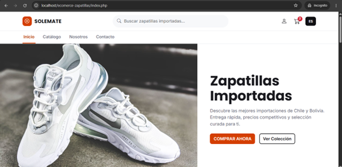

### Modularización con includes (SSI)

Estructura de la carpeta `includes/` y una vista que los trae con `require_once`:

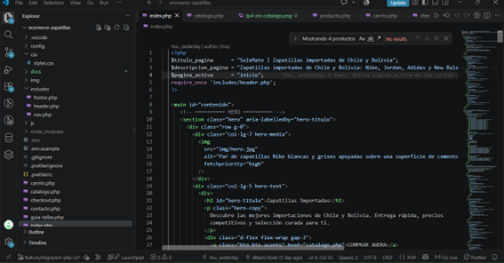

Menú principal en `includes/nav.php`, con la clase `active` decidida por PHP:

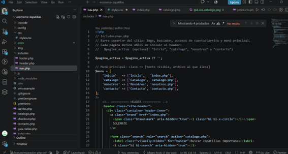

### Navegación dinámica (SSR)

Cada vista muestra su propio título en la pestaña y resalta su sección en el menú. En el catálogo:

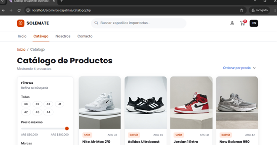

En contacto:

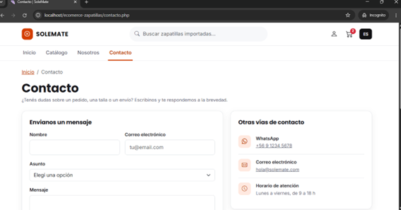

### Variables de entorno

El archivo `.env.example` está en el repositorio como plantilla; el `.env` real queda fuera de Git:

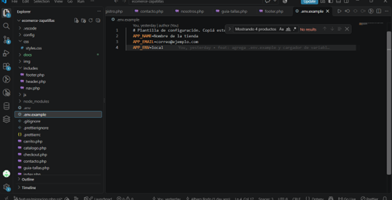

### Seguridad: prevención de XSS

Al buscar `<script>alert('XSS')</script>`, el catálogo muestra el texto tal cual, sin ejecutarlo, porque se imprime con `htmlspecialchars()`:

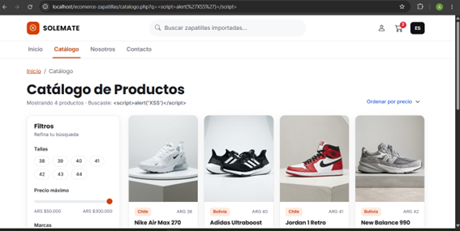

## Clase 5: Procesamiento de formularios y seguridad web (TP N° 5)

Todo el desarrollo de este trabajo práctico está en la carpeta [`clase5/`](clase5/), que parte de una copia del proyecto del TP N° 4 e incorpora el procesamiento de formularios del lado del servidor, con sanitización y validación para prevenir **XSS** (_Cross-Site Scripting_).

| Requisito de la consigna   | Cómo se resolvió                                                                                                                                                                                                                 |
| -------------------------- | -------------------------------------------------------------------------------------------------------------------------------------------------------------------------------------------------------------------------------- |
| **Formulario por POST**    | `clase5/contacto.php`: formulario de contacto (nombre, correo, asunto y mensaje) que se envía y se procesa en la misma página.                                                                                                   |
| **Formulario por GET**     | `clase5/catalogo.php`: buscador del menú y filtros del catálogo (tallas, precio máximo, marcas y origen), que filtran los productos de verdad.                                                                                   |
| **Sanitización estricta**  | Todo dato de `$_POST` o `$_GET` pasa por `isset`, `is_string` y `trim()`; el correo, además, por `filter_var()` con `FILTER_SANITIZE_EMAIL`. Al imprimir se usa `e()`, que aplica `htmlspecialchars()` con `ENT_QUOTES` y UTF-8. |
| **Validación en servidor** | Campos obligatorios no vacíos, formato de correo con `FILTER_VALIDATE_EMAIL`, largos mínimos y máximos, y valores permitidos mediante listas blancas.                                                                            |
| **Mensajes al usuario**    | Aviso verde si el envío fue exitoso; aviso rojo y un texto bajo cada campo con error. En el catálogo: cantidad real de resultados, aviso si no hay coincidencias y aviso si se ignoró un filtro inválido.                        |
| **Persistencia de datos**  | Si hay errores, el formulario conserva lo escrito. En el catálogo se mantienen las casillas marcadas, el deslizador de precio y la búsqueda.                                                                                     |

### Formulario POST: contacto

El formulario de [`clase5/contacto.php`](clase5/contacto.php) se envía por **POST** a la misma página, que lo procesa antes de dibujar el HTML. Lleva el atributo `novalidate` para que el navegador no bloquee el envío: los atributos `required` y `type="email"` quedan como ayuda de usabilidad, pero la validación que cuenta es la del servidor.

| Campo     | Reglas en el servidor                                                                     |
| --------- | ----------------------------------------------------------------------------------------- |
| `nombre`  | Obligatorio; máximo 80 caracteres                                                         |
| `email`   | Obligatorio; se sanea con `FILTER_SANITIZE_EMAIL` y se valida con `FILTER_VALIDATE_EMAIL` |
| `asunto`  | Debe ser una de las 4 opciones permitidas (lista blanca comprobada con `in_array`)        |
| `mensaje` | Obligatorio; entre 10 y 1000 caracteres                                                   |

Extracto simplificado de la lógica:

```php
if ($_SERVER['REQUEST_METHOD'] === 'POST') {            // solo si llegó por POST
    $nombre = dato_post('nombre');                        // isset + is_string + trim
    $email  = filter_var(dato_post('email'), FILTER_SANITIZE_EMAIL);

    if ($nombre === '') {
        $errores['nombre'] = 'El nombre es obligatorio.';
    }
    if (!filter_var($email, FILTER_VALIDATE_EMAIL)) {
        $errores['email'] = 'Ingresá un correo electrónico válido (por ejemplo, tu@email.com).';
    }
    // ... el asunto y el mensaje se validan de forma similar

    if (empty($errores)) {
        $exito = true;                                    // se muestra el aviso verde
    }
}
```

Los datos no se escapan al recibirlos sino **al imprimirlos** con `e()` (por ejemplo, `value="<?= e($datos['nombre']) ?>"`), para no mostrar mal un apóstrofo como en _D'Angelo_ y, a la vez, neutralizar cualquier etiqueta HTML.

Con el formulario vacío se muestra un aviso general y un mensaje bajo cada campo:

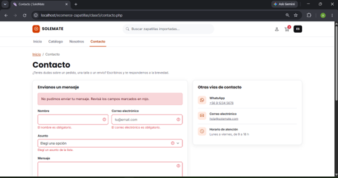

Con un correo inválido, solo ese campo marca error y los demás **conservan lo escrito**:

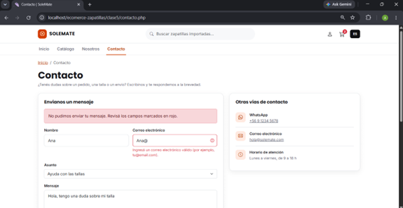

Con datos correctos, se muestra el aviso de éxito y el formulario queda vacío:

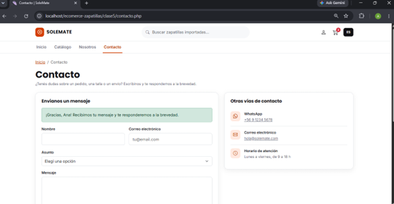

**Prueba de XSS en el cuerpo de la página:** al escribir `<script>alert('XSS')</script>` como nombre, el aviso lo muestra como texto y no se ejecuta nada:

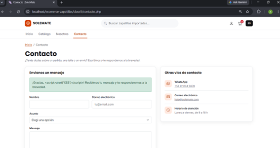

**Prueba de XSS dentro de un atributo:** al escribir `">` como nombre, el campo vuelve a mostrar ese texto literal y no se rompe el atributo `value`, porque `e()` usa `ENT_QUOTES`:

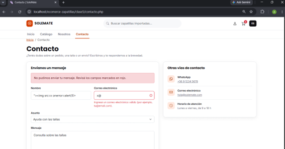

### Formulario GET: buscador y filtros del catálogo

El buscador del menú y el panel de filtros de [`clase5/catalogo.php`](clase5/catalogo.php) se envían por **GET**: los datos viajan en la URL, de modo que cada búsqueda se puede guardar en favoritos o compartir como enlace. Los 4 productos están en un arreglo PHP y se filtran en el servidor.

| Parámetro    | Origen                                          | Validación en el servidor                                          |
| ------------ | ----------------------------------------------- | ------------------------------------------------------------------ |
| `q`          | Buscador del menú (y un campo oculto del panel) | `isset`, `is_string` y `trim()`; máximo 60 caracteres              |
| `talla[]`    | Casillas de talla                               | `FILTER_VALIDATE_INT` y debe estar en la lista de tallas (38 a 44) |
| `marca[]`    | Casillas de marca                               | Debe ser una clave de la lista de marcas                           |
| `origen[]`   | Casillas de origen                              | Debe ser una clave de la lista de orígenes                         |
| `precio_max` | Deslizador de precio                            | `FILTER_VALIDATE_INT` con `min_range` 50000 y `max_range` 300000   |

Reglas del filtrado:

- Un valor inválido (una talla inventada, un precio fuera de rango, un dato que no es texto) **se ignora** y se muestra un aviso, sin romper la página.
- Entre grupos de filtros se combinan con **Y** (Nike **y** Bolivia) y dentro de un grupo con **O** (Nike **o** Jordan).
- Si un grupo no tiene nada marcado, no filtra. El botón **Limpiar** vuelve al catálogo sin filtros.

Ejemplo de URL: `catalogo.php?marca[]=nike&marca[]=jordan&origen[]=chile&precio_max=250000`

Filtros aplicados: los datos viajan en la URL, las casillas y el deslizador se conservan y el contador muestra la cantidad real de productos:

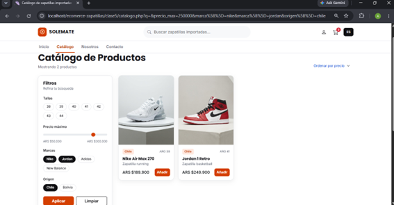

Cuando ningún producto cumple los filtros, se muestra un mensaje con una salida:

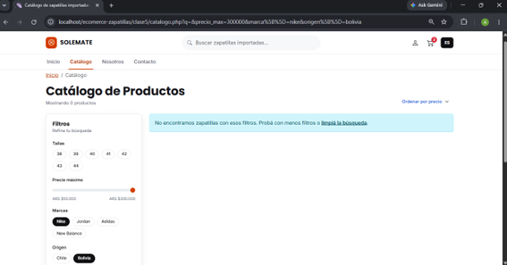

Cuando llegan valores inválidos por la URL, se ignoran y se avisa:

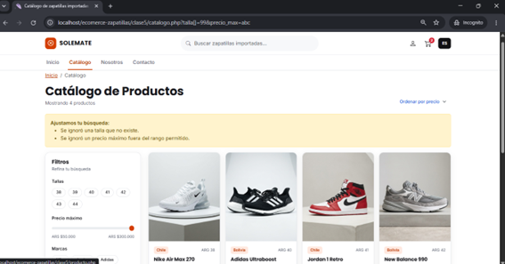

**Prueba de XSS en la búsqueda:** el texto buscado se muestra como texto, sin ejecutarse:

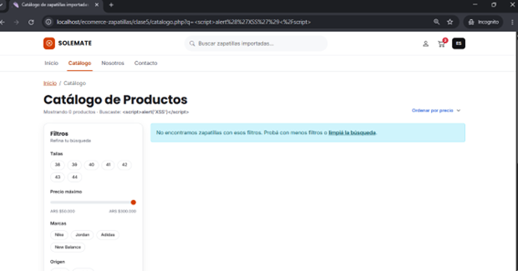

Búsqueda de texto desde el menú (por nombre, marca o tipo de producto):

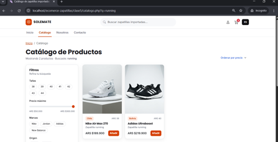

### Funciones auxiliares (`clase5/includes/funciones.php`)

| Función                   | Qué hace                                                                                      |
| ------------------------- | --------------------------------------------------------------------------------------------- |
| `e($texto)`               | Escapa un valor para imprimirlo en HTML: `htmlspecialchars()` con `ENT_QUOTES` y UTF-8        |
| `dato_post('campo')`      | Lee un campo de `$_POST`; devuelve `''` si no existe o no es texto, y aplica `trim()`         |
| `dato_get('campo')`       | Lo mismo para `$_GET`                                                                         |
| `dato_get_lista('campo')` | Lee un campo de `$_GET` con varios valores (`name="marca[]"`) y descarta los que no son texto |

## Clase 6: Diseño y creación del esquema relacional en MySQL (TP N° 6)

Todo el desarrollo de este trabajo práctico está en la carpeta [`tp6/`](tp6/): el diseño de la base de datos **`solemate_db`** del e-commerce, normalizada hasta la **3FN**, su script de creación y las consultas de prueba **CRUD**. Esta base es el insumo del TP N° 7, en el que el sitio se conectará a MySQL con PDO.

| Requisito de la consigna    | Cómo se resolvió                                                                                                                                                                                                                                              |
| --------------------------- | ------------------------------------------------------------------------------------------------------------------------------------------------------------------------------------------------------------------------------------------------------------- |
| **Parte 1: normalización**  | [`tp6/NORMALIZACION.md`](tp6/NORMALIZACION.md): tabla de pedidos sin normalizar (lista de productos en una celda y datos del cliente repetidos), paso a paso por 1FN, 2FN y 3FN, listado final de tablas con PK y FK, y diagrama entidad-relación en Mermaid. |
| **Parte 2: script DDL**     | [`tp6/schema.sql`](tp6/schema.sql): crea la base `solemate_db` (utf8mb4) con 11 tablas InnoDB, claves primarias `INT AUTO_INCREMENT`, 10 claves foráneas, campos de auditoría `created_at` y `updated_at`, y 2 índices explícitos.                            |
| **Parte 3: consultas CRUD** | [`tp6/consultas.sql`](tp6/consultas.sql): inserta los datos reales del catálogo, consulta con `WHERE` + `ORDER BY` y con `INNER JOIN`, actualiza un precio y el estado de un pedido, y da de baja un producto de prueba.                                      |
| **Prueba local**            | Ambos scripts se ejecutan sin errores en XAMPP (MariaDB 10.11), tanto desde phpMyAdmin como desde la terminal.                                                                                                                                                |

### Tablas del esquema

| Tipo                   | Tablas                                                                                     |
| ---------------------- | ------------------------------------------------------------------------------------------ |
| Usuarios               | `usuarios`: email único, contraseña cifrada con `password_hash()`, rol y datos personales  |
| Maestras               | `roles`, `marcas`, `categorias`, `origenes`, `provincias` y `estados_pedido`               |
| Principales de negocio | `productos` y `pedidos`                                                                    |
| Relación / detalle     | `detalle_pedidos` (N:M entre pedidos y productos) y `producto_talle` (stock de cada talle) |

Decisiones de diseño:

- **Dos precios:** `productos.precio` es el precio actual del catálogo y `detalle_pedidos.precio_unitario` guarda el precio al que se vendió, para que un aumento no altere los pedidos ya realizados.
- **Integridad referencial:** las claves foráneas usan `ON DELETE RESTRICT` (no se puede borrar una marca en uso ni un producto ya vendido), salvo el detalle de un pedido y el stock de un producto, que usan `ON DELETE CASCADE`.
- **Combinaciones únicas:** `UNIQUE (pedido_id, producto_id, talle)` y `UNIQUE (producto_id, talle)` conservan la clave compuesta que surgió en la 2FN.
- **Índices:** `idx_productos_precio` (filtro de precio máximo y orden por precio del catálogo) e `idx_pedidos_created_at` (historial de pedidos por fecha). No se indexaron `usuarios.email` ni las claves foráneas porque MySQL ya les crea un índice automático.
- **Script reejecutable:** `schema.sql` empieza con `DROP DATABASE IF EXISTS`, así se puede ejecutar varias veces y funciona igual en MariaDB (XAMPP) y en MySQL 8.

### Esquema en phpMyAdmin

Importación de `schema.sql` sin errores:

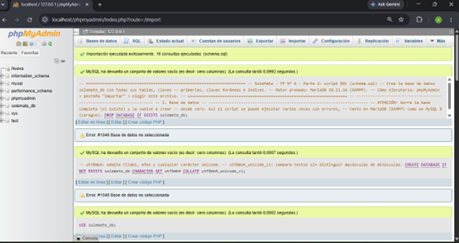

Las 11 tablas de `solemate_db`, con motor InnoDB y cotejamiento `utf8mb4_unicode_ci`:

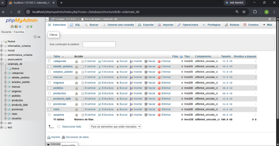

Estructura de `productos`, con sus tipos de datos y campos de auditoría:

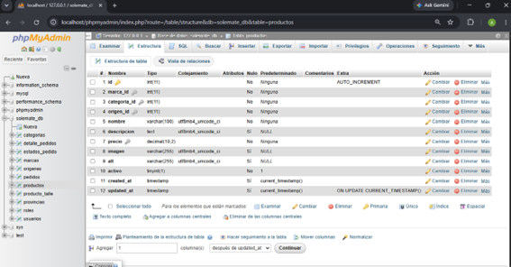

Índices de `productos`: la clave primaria, las tres claves foráneas y el índice explícito sobre `precio`:

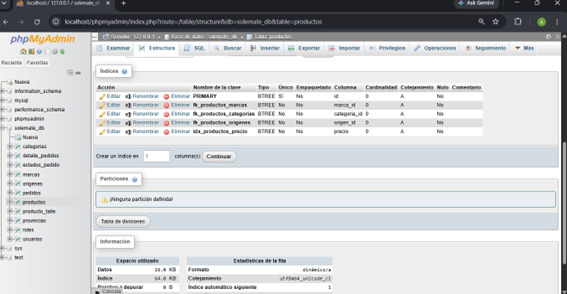

Relaciones entre las tablas en el Diseñador de phpMyAdmin (el diagrama entidad-relación completo está en [NORMALIZACION.md](tp6/NORMALIZACION.md)):

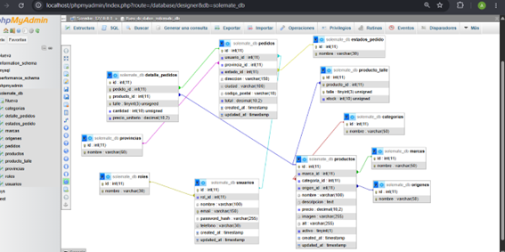

### Consultas CRUD

Importación de `consultas.sql` sin errores:

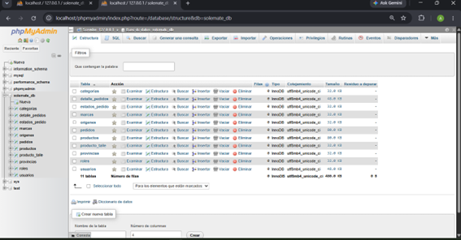

**Read con `WHERE` y `ORDER BY`:** productos visibles de hasta $230.000, del más barato al más caro:

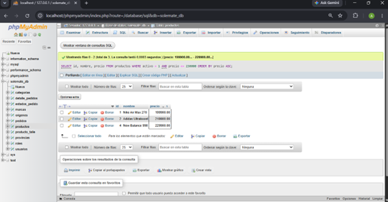

**Read con `INNER JOIN` de 6 tablas:** reconstruye los pedidos de la tabla sin normalizar a partir de las tablas normalizadas:

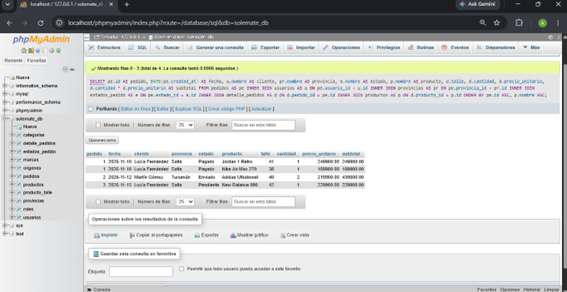

**Update:** la Nike Air Max 270 sube a $199.900 en el catálogo, pero el pedido 1 conserva el precio al que se vendió:

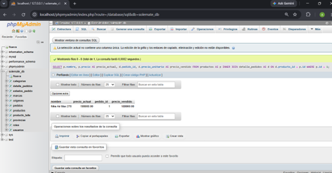

**Delete:** el producto de prueba (id 5) se dio de baja y su stock se borró en cascada; quedan los 4 productos reales:

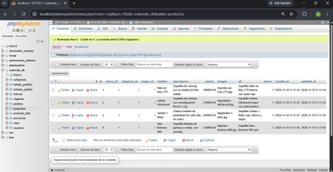

## Clase 7: Persistencia y conexión PHP-MySQL segura (TP N° 7)

El sitio se conectó a la base `solemate_db` del TP N° 6 mediante **PDO**. A diferencia del TP N° 5 y del TP N° 6, este trabajo se desarrolló **en la aplicación principal** (la raíz del repositorio) y no en una carpeta aparte, porque la consigna pide integrar el CRUD a las vistas del sitio y el TP N° 8 continúa sobre la misma aplicación. Las carpetas `clase5/` y `tp6/` se conservan como registro de esos trabajos.

| Requisito de la consigna             | Cómo se resolvió                                                                                                                                                                                                                                                                                                                                                                                                                         |
| ------------------------------------ | ---------------------------------------------------------------------------------------------------------------------------------------------------------------------------------------------------------------------------------------------------------------------------------------------------------------------------------------------------------------------------------------------------------------------------------------- |
| **Conexión segura (`conexion.php`)** | `config/conexion.php` crea la instancia PDO con `ERRMODE_EXCEPTION`, `FETCH_ASSOC` y `EMULATE_PREPARES` en `false`, dentro de un `try-catch` de `PDOException`. Las credenciales se leen del `.env` (ignorado por Git) con `config/env.php`; el repositorio solo tiene las claves de ejemplo en `.env.example`. Si la conexión falla, el detalle técnico va al log del servidor con `error_log()` y el visitante ve un mensaje genérico. |
| **Módulo CRUD**                      | Panel de administración de **productos** en `admin/`: listado (`index.php`), alta (`crear.php`), modificación (`editar.php`) y baja (`eliminar.php`).                                                                                                                                                                                                                                                                                    |
| **Integración con el sitio**         | El panel usa las mismas plantillas (`header`, `nav` y `footer`), Bootstrap y estilos del sitio, y se abre desde el ícono de tablero de la barra superior. El catálogo (`catalogo.php`) y el detalle (`producto.php?id=…`) leen los productos de la base, así que cada cambio del panel se refleja al instante en la tienda.                                                                                                              |
| **Entidad del modelo del TP N° 6**   | Tabla `productos`, con sus claves foráneas a `marcas`, `categorias` y `origenes` (listas desplegables cargadas desde la base) y el stock por talle de `producto_talle` en el catálogo y en el detalle.                                                                                                                                                                                                                                   |
| **Sentencias preparadas**            | Todas las consultas (`SELECT`, `INSERT`, `UPDATE` y `DELETE`) usan `prepare()` + `execute()` con `:parametros`. Ningún dato del usuario se concatena en el SQL.                                                                                                                                                                                                                                                                          |
| **Sanitización XSS**                 | Todo lo que se imprime en las vistas pasa por `e()`, que aplica `htmlspecialchars()` con `ENT_QUOTES` y UTF-8.                                                                                                                                                                                                                                                                                                                           |
| **Demostración en vivo**             | Ver [Ejecutar el TP N° 7](#ejecutar-el-tp-n-7-crud-con-mysql).                                                                                                                                                                                                                                                                                                                                                                           |

### Archivos del módulo

| Archivo                         | Función                                                                                                                            |
| ------------------------------- | ---------------------------------------------------------------------------------------------------------------------------------- |
| `config/conexion.php`           | Conexión PDO con `try-catch`                                                                                                       |
| `includes/funciones.php`        | Funciones auxiliares del TP N° 5 (`e()`, `dato_post()`, `dato_get()` y `dato_get_lista()`), incorporadas a la aplicación principal |
| `admin/index.php`               | **Read:** listado de productos con `INNER JOIN` y mensajes de resultado                                                            |
| `admin/crear.php`               | **Create:** formulario, validación e `INSERT`                                                                                      |
| `admin/editar.php`              | **Update:** carga del producto por `id` (`SELECT … WHERE id = :id`) y `UPDATE`                                                     |
| `admin/eliminar.php`            | **Delete:** `DELETE` por POST                                                                                                      |
| `admin/producto_comun.php`      | Validación y parámetros compartidos por el alta y la edición                                                                       |
| `admin/formulario_producto.php` | Formulario compartido por el alta y la edición                                                                                     |
| `catalogo.php`                  | Catálogo desde la base, con los filtros del TP N° 5 convertidos en condiciones preparadas                                          |
| `producto.php`                  | Detalle de producto por `id`, con stock por talle y productos relacionados                                                         |

### Decisiones de diseño

- **Validación en el servidor:** el nombre es obligatorio (hasta 100 caracteres); la marca, la categoría y el origen deben existir en la base; el precio va de 1.000 a 99.999.999 (el mínimo detecta el error de escribir "189.900" con punto de miles); la imagen se elige de la carpeta `img/`, y el texto alternativo es obligatorio si hay imagen. Ante un error, el formulario conserva los datos y marca cada campo.
- **Patrón PRG (Post/Redirect/Get):** después de crear, editar o eliminar se redirige al listado con `?status=…`, así recargar la página no repite la operación. El listado solo muestra mensajes de una lista blanca.
- **Baja segura:** se elimina por POST y con confirmación, nunca con un enlace GET. Un producto con ventas no se puede borrar (la clave foránea de `detalle_pedidos` es `ON DELETE RESTRICT`): la excepción `23000` se convierte en un aviso, y el producto se puede ocultar desmarcando "Visible en el catálogo" (columna `activo`).
- **Validación de `id`:** los `id` que llegan por la URL o por un formulario se validan con `FILTER_VALIDATE_INT` antes de consultar la base.
- **Listas blancas en `ORDER BY` y en nombres de tabla:** como no admiten `:parametros`, solo se aceptan valores fijos definidos en el código.
- **Rutas desde subcarpetas:** las plantillas anteponen `$ruta_base` a las rutas internas; las páginas de `admin/` lo definen como `'../'`.
- **Base para el TP N° 8:** cada página resuelve su lógica antes de incluir el encabezado (lo necesitan `session_start()` y las redirecciones), y el panel está agrupado en `admin/`, así que protegerlo solo requería incluir el guardián de rutas al principio de cada archivo. **Desde el TP N° 8, el panel solo lo puede usar el rol Administrador** (ver [Clase 8](#clase-8-manejo-de-estado-sesiones-y-autenticación-tp-n-8)).

### Evidencia de funcionamiento

Panel de productos (**Read**), con los nombres de marca, categoría y origen obtenidos con `INNER JOIN`:

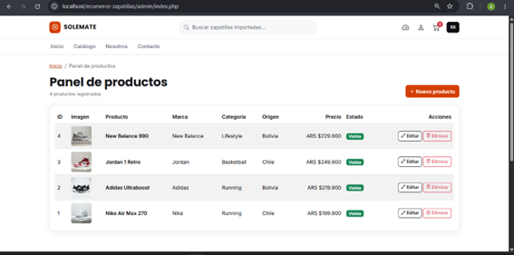

**Create:** validación en el servidor, con los datos conservados y los errores marcados en cada campo:

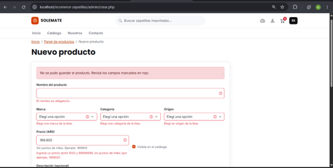

Producto creado y redirección al listado con el mensaje de éxito:

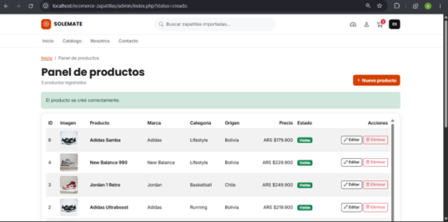

El producto nuevo aparece al instante en el catálogo público:

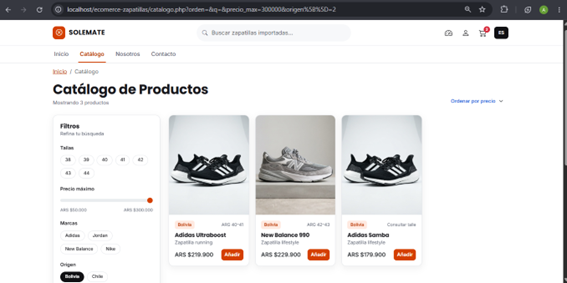

Y queda guardado en MySQL (phpMyAdmin):

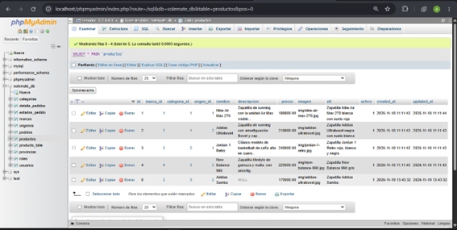

**Update:** precio modificado desde el panel:

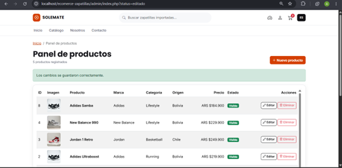

Detalle de producto leído de la base según su `id`, con los talles con stock:

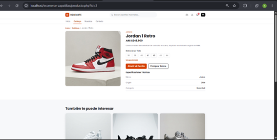

**Delete:** un producto con ventas no se puede eliminar (integridad referencial):

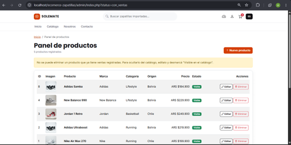

Un producto sin ventas se elimina correctamente:

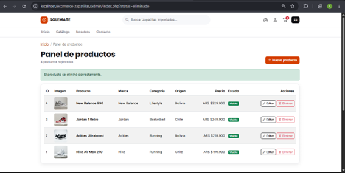

### Pruebas de seguridad

**Inyección SQL y XSS en el formulario:** el nombre `Prueba <script>alert('XSS')</script> '); DROP TABLE productos; --` se guardó como texto, la tabla sigue intacta y el script no se ejecutó:

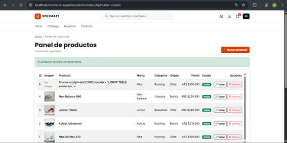

**Inyección SQL y XSS en la búsqueda (GET):** `<script>alert(1)</script>' OR '1'='1` se busca como texto literal (0 resultados) y se muestra sin ejecutarse:

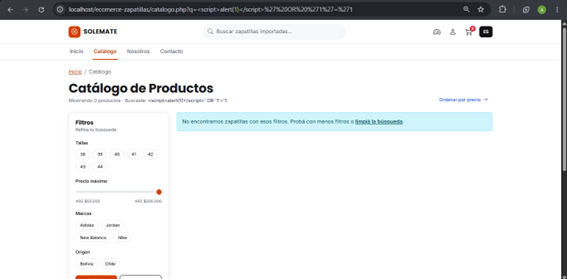

**Error de conexión controlado:** con MySQL detenido, el `try-catch` muestra un mensaje genérico sin datos internos:

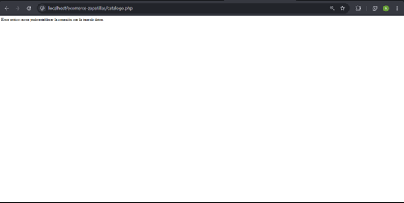

## Clase 8: Manejo de estado, sesiones y autenticación (TP N° 8)

El sitio incorporó **registro, inicio y cierre de sesión** con sesiones de PHP, contraseñas cifradas con **bcrypt** y un **guardián de rutas** con control de acceso por rol. Igual que el TP N° 7, se desarrolló **en la aplicación principal**: el panel `admin/` que en el TP N° 7 estaba abierto a cualquier visitante ahora solo lo puede usar el rol Administrador.

| Requisito de la consigna                         | Cómo se resolvió                                                                                                                                                                                                                                                                                                                                                     |
| ------------------------------------------------ | -------------------------------------------------------------------------------------------------------------------------------------------------------------------------------------------------------------------------------------------------------------------------------------------------------------------------------------------------------------------- |
| **Base de datos (`usuarios`)**                   | Se usa la tabla `usuarios` del TP N° 6, que ya tenía `id`, `nombre`, `email` único, `password_hash` (VARCHAR 255) y `created_at`. El rol se guarda en `rol_id`, clave foránea a la tabla `roles` (ver la equivalencia más abajo). No hizo falta modificar la base.                                                                                                   |
| **Registro (`registro.php`)**                    | Validación estricta en el servidor (el nombre solo admite letras, espacios, apóstrofo, punto y guion; correo con `filter_var()`; contraseña de 8 a 72 caracteres repetida dos veces; aceptación de términos). Verifica con un `SELECT` preparado que el correo no exista, cifra con `password_hash($password, PASSWORD_BCRYPT)` e inserta con un `INSERT` preparado. |
| **Autenticación (`login.php`)**                  | Busca al usuario por correo (con un `JOIN` a `roles`) y compara con `password_verify()`. Si es correcto: `session_start()` (en `includes/sesion.php`), `session_regenerate_id(true)`, guarda `$_SESSION['usuario_id']`, `$_SESSION['usuario_nombre']` y `$_SESSION['rol']`, y redirige al panel (Administrador) o a `mi-cuenta.php` (Cliente).                    |
| **Guardián de rutas (`includes/auth_guard.php`)** | Script reutilizable que verifica `isset($_SESSION['usuario_id'])` y, si no hay sesión, redirige a `login.php?error=acceso_denegado`. La función `verificarRol('Administrador')` responde **403 Prohibido** a cualquier otro rol.                                                                                                                                      |
| **Vistas protegidas**                            | Solo rol Administrador: las 4 páginas del panel (`admin/index.php`, `crear.php`, `editar.php` y `eliminar.php`). Cualquier usuario con sesión: `mi-cuenta.php` y `checkout.php`.                                                                                                                                                                                     |
| **Cierre de sesión (`logout.php`)**              | Vacía `$_SESSION`, borra la cookie de sesión del navegador (`setcookie()` con vencimiento en el pasado), destruye la sesión con `session_destroy()` y redirige al login.                                                                                                                                                                                           |
| **Cookies de sesión seguras**                    | `includes/sesion.php` configura `cookie_httponly`, `use_only_cookies`, `use_strict_mode`, `cookie_samesite = Lax` y `cookie_secure` cuando el sitio se sirve por HTTPS.                                                                                                                                                                                            |
| **Integración en la aplicación principal**       | Todo funciona con las plantillas del sitio. La barra superior cambia según la sesión: el ícono del panel solo lo ve el Administrador, y con la sesión iniciada aparecen "Mi cuenta" (con el nombre) y "Cerrar sesión".                                                                                                                                              |

### Equivalencia con la estructura recomendada

La consigna recomienda una tabla `usuarios` con las columnas `password` y `rol` (texto `'admin'` / `'usuario'`). Se conservó el diseño normalizado del TP N° 6, que cumple la misma función:

| Consigna                        | SoleMate (`solemate_db`)                                              | Motivo                                                                                                                                                         |
| ------------------------------- | --------------------------------------------------------------------- | -------------------------------------------------------------------------------------------------------------------------------------------------------------- |
| `password` VARCHAR(255)         | `password_hash` VARCHAR(255)                                          | El nombre deja claro que guarda un hash y nunca la contraseña.                                                                                                |
| `rol` VARCHAR (`'admin'` / `'usuario'`) | `rol_id` → tabla `roles` (`Administrador` / `Cliente`)        | Diseño en 3FN del TP N° 6: los nombres de rol no se repiten en cada fila y no se pueden escribir mal. En el login, un `JOIN` trae el nombre del rol para `$_SESSION['rol']`. |
| `admin_panel.php`               | `admin/index.php`                                                     | El panel del TP N° 7 ya existía con ese nombre; se protege con `verificarRol('Administrador')`.                                                                |
| `auth_guard.php`                | `includes/auth_guard.php`                                             | Va junto a las demás piezas reutilizables (`header.php`, `nav.php`, `funciones.php`).                                                                          |

### Archivos del módulo

| Archivo                   | Función                                                                                                         |
| ------------------------- | --------------------------------------------------------------------------------------------------------------- |
| `includes/sesion.php`     | Inicia la sesión con la configuración segura de la cookie. Lo incluyen `header.php`, el login, el logout y el guardián |
| `registro.php`            | Registro de clientes con validación, control de correo duplicado y `PASSWORD_BCRYPT`                            |
| `login.php`               | Inicio de sesión con `password_verify()`, `session_regenerate_id(true)` y redirección según el rol              |
| `logout.php`              | Cierre de sesión: vacía `$_SESSION`, borra la cookie y destruye la sesión                                       |
| `includes/auth_guard.php` | Guardián de rutas (autenticación) y `verificarRol()` (autorización)                                             |
| `includes/prohibido.php`  | Página "403 Acceso prohibido" con el diseño del sitio                                                           |
| `mi-cuenta.php`           | Vista protegida con los datos de la cuenta; destino del cliente tras el login                                   |
| `checkout.php`            | Exige sesión iniciada para finalizar la compra                                                                  |
| `includes/nav.php`        | Accesos de la barra según la sesión y el rol                                                                    |
| `admin/*.php`             | Las 4 páginas del panel incluyen el guardián y `verificarRol('Administrador')`                                  |

### Acceso a cada página según el rol

| Página                              | Visitante sin sesión            | Cliente                  | Administrador |
| ----------------------------------- | ------------------------------- | ------------------------ | ------------- |
| Tienda (inicio, catálogo, producto…) | ✅                              | ✅                       | ✅            |
| `registro.php` y `login.php`        | ✅                              | Redirige a su página     | Redirige al panel |
| `mi-cuenta.php` y `checkout.php`    | ➡️ `login.php?error=acceso_denegado` | ✅                  | ✅            |
| `admin/` (listado, alta, edición y baja) | ➡️ `login.php?error=acceso_denegado` | ⛔ 403 Prohibido | ✅            |

### Decisiones de diseño

- **Sesión centralizada:** `session_start()` y la configuración de la cookie están en un solo archivo (`includes/sesion.php`). Como cada página resuelve su lógica antes de incluir el encabezado (base que dejó el TP N° 7), la sesión siempre se inicia antes de enviar HTML.
- **`cookie_secure` condicional:** la teoría recomienda `session.cookie_secure = 1`, que obliga a usar HTTPS. En XAMPP el sitio se sirve por HTTP, así que la cookie se marca como `Secure` solo cuando la página llega por HTTPS; si no, el navegador nunca la devolvería y el login no funcionaría.
- **Protección extra de la sesión:** `use_strict_mode` hace que PHP rechace identificadores de sesión inventados (complementa a `session_regenerate_id(true)` contra la fijación de sesión) y `SameSite=Lax` impide que otro sitio envíe formularios con la sesión del usuario.
- **Mensajes genéricos en el login:** si el correo no existe o la contraseña es incorrecta, el mensaje es el mismo ("Correo o contraseña incorrectos"), para no revelar qué correos están registrados.
- **Datos mínimos en la sesión:** solo `usuario_id`, `usuario_nombre` y `rol`; nunca la contraseña ni su hash. `mi-cuenta.php` lee el resto de los datos de la base con el `usuario_id`.
- **Largo de la contraseña:** de 8 a 72 caracteres, porque bcrypt solo usa los primeros 72 bytes.
- **Correo en minúsculas:** el registro y el login convierten el correo a minúsculas, así `Lucia@Mail.com` y `lucia@mail.com` son la misma cuenta. Si dos personas intentan registrar el mismo correo al mismo tiempo, el índice único de la base lo impide (error `1062`) y se muestra el mismo aviso.
- **Patrón PRG y listas blancas:** el registro redirige a `login.php?status=registrado`, y el login solo muestra los avisos de una lista blanca (`acceso_denegado`, `registrado` y `logout`), igual que los `?status=` del panel.
- **403 con el diseño del sitio:** `verificarRol()` responde con el código HTTP 403 y muestra una página con el encabezado y el pie del sitio, en lugar de un mensaje suelto.
- **Rutas desde subcarpetas:** el guardián antepone `$ruta_base` a `login.php`, así redirige bien desde la raíz y desde `admin/`.
- **Base para el TP N° 9:** como `sesion.php` y el guardián están separados del HTML, los futuros endpoints JSON (`api/*.php`) podrán abrir la sesión y verificar al usuario sin cargar las plantillas.

### Evidencia de funcionamiento

**Registro con validación en el servidor:** un nombre con `<script>` se rechaza y se muestra como texto (no se ejecuta), el correo ya registrado se detecta, y se marcan las contraseñas distintas y los términos sin aceptar:

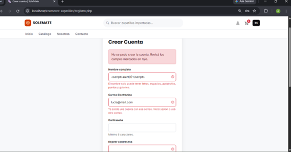

Registro correcto: redirección al login con el mensaje de éxito (patrón PRG):

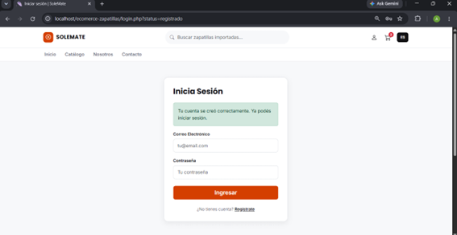

En la base, la contraseña queda guardada como hash **bcrypt** (`$2y$10$…`), nunca en texto plano:

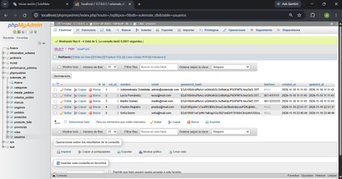

Credenciales incorrectas: mensaje genérico que no revela si el correo existe:

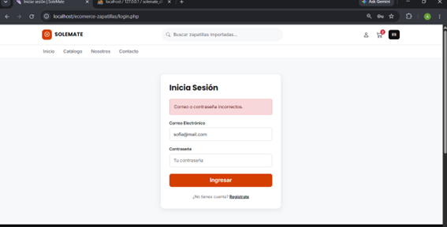

Cookie `PHPSESSID` antes del login, con `HttpOnly` y `SameSite=Lax`:

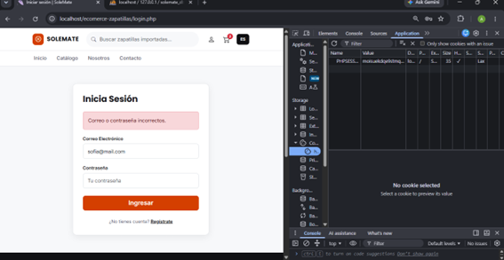

Después del login, el cliente llega a **Mi cuenta**, la barra muestra su nombre y el `PHPSESSID` **cambió de valor**: es el efecto de `session_regenerate_id(true)` contra la fijación de sesión:

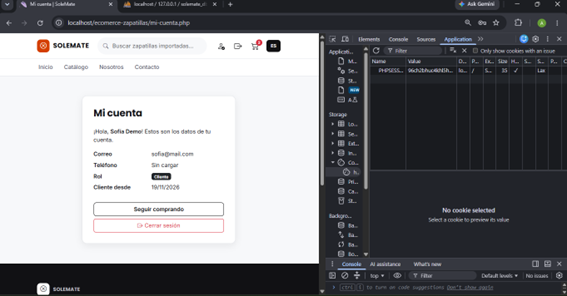

Los datos de `$_SESSION` se guardan en el servidor (archivo `sess_…` de XAMPP), no en el navegador:

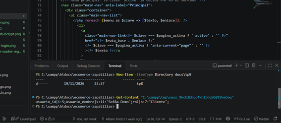

**Control por rol:** un Cliente que escribe la URL del panel recibe un **403 Prohibido**:

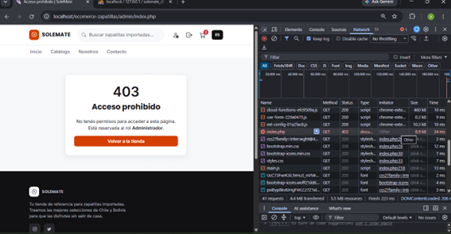

**Logout:** la sesión se destruye y se vuelve al login con un aviso:

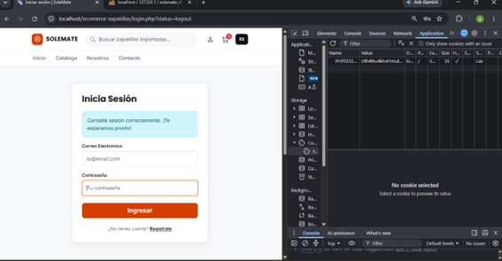

**Guardián de rutas:** sin sesión, el panel redirige a `login.php?error=acceso_denegado`:

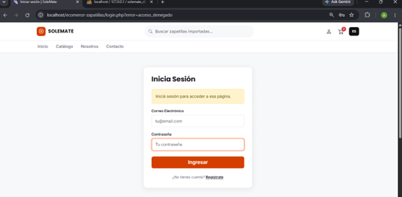

El Administrador entra directo al panel, y solo él ve el acceso al panel en la barra:

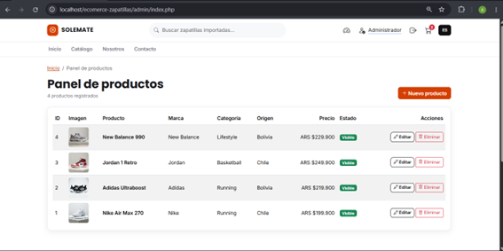

## Diseño en Figma


### Paleta y tipografías

| Uso                     | Color     |
| ----------------------- | --------- |
| Naranja vivo (detalles) | `#FF4D00` |
| Naranja de botones      | `#D43F00` |
| Rojo (contador)         | `#D62839` |
| Amarillo (estrellas)    | `#FFB400` |
| Oscuro (footer)         | `#111114` |
| Fondo suave             | `#F7F8FA` |

- **Títulos:** Poppins
- **Textos:** Inter

El naranja del diseño original (`#FF4D00`) no alcanza el contraste mínimo de 4,5:1 con texto blanco, por lo que en botones se usa `#D43F00`, casi idéntico a la vista y accesible.

## Tecnologías

- HTML5 semántico
- CSS3 con variables personalizadas
- [Bootstrap 5.3.3](https://getbootstrap.com/) y [Bootstrap Icons 1.11.3](https://icons.getbootstrap.com/)
- JavaScript (archivo base `js/main.js`)
- **PHP 8** (includes con `require_once`, variables, constantes y `htmlspecialchars()`)
- **PDO** con consultas preparadas (conexión a MySQL, desde el TP N° 7)
- **Sesiones de PHP** (`$_SESSION`) y `password_hash()` / `password_verify()` con bcrypt (autenticación, desde el TP N° 8)
- **XAMPP** (servidor Apache con PHP para desarrollo local)
- **MySQL / MariaDB 10.11** y **phpMyAdmin** (base de datos relacional, desde el TP N° 6)
- Variables de entorno con archivo `.env`
- Google Fonts (Poppins e Inter)
- Prettier (formateo de código)
- Lighthouse (auditoría de accesibilidad, buenas prácticas y SEO)
- Git y GitHub
- VSCode y Figma (diseño)

## Estructura del proyecto

```
ecommerce-zapatillas/
├── config/
│   ├── env.php               # lee el archivo .env y define las constantes
│   └── conexion.php          # conexión PDO con try-catch (TP N° 7)
├── includes/
│   ├── header.php            # <head>, metadatos y estilos
│   ├── nav.php               # barra superior y menú principal
│   ├── footer.php            # pie de página y scripts
│   ├── funciones.php         # e(), dato_post(), dato_get() y dato_get_lista()
│   ├── sesion.php            # inicio de sesión con cookie segura (TP N° 8)
│   ├── auth_guard.php        # guardián de rutas y verificarRol() (TP N° 8)
│   └── prohibido.php         # página 403 Acceso prohibido (TP N° 8)
├── admin/                    # panel de administración: CRUD de productos (TP N° 7), solo Administrador (TP N° 8)
│   ├── index.php             # Read: listado
│   ├── crear.php             # Create: alta
│   ├── editar.php            # Update: modificación
│   ├── eliminar.php          # Delete: baja por POST
│   ├── producto_comun.php    # validación compartida
│   └── formulario_producto.php  # formulario compartido
├── css/
│   └── styles.css
├── js/
│   └── main.js
├── img/                      # fotografías de productos y hero
├── docs/
│   ├── auditoria-lighthouse.md
│   ├── diseno/               # capturas del diseño de Figma
│   ├── lighthouse/           # capturas de la auditoría
│   ├── tp4-*.png             # capturas del TP N° 4
│   ├── tp7/                  # capturas tp7-*.png del TP N° 7
│   └── tp8/                  # capturas tp8-*.png del TP N° 8
├── .vscode/settings.json     # formateo con Prettier al guardar
├── .env.example              # plantilla de variables de entorno
├── .gitignore                # ignora .env y node_modules
├── .prettierrc
├── .prettierignore
├── index.php
├── catalogo.php
├── producto.php
├── carrito.php
├── login.php                 # inicio de sesión (TP N° 8)
├── registro.php              # registro de clientes (TP N° 8)
├── logout.php                # cierre de sesión (TP N° 8)
├── mi-cuenta.php             # vista protegida de la cuenta (TP N° 8)
├── guia-tallas.php
├── checkout.php              # requiere sesión iniciada (TP N° 8)
├── contacto.php
├── nosotros.php
├── clase5/                       # desarrollo del TP N° 5 (formularios y seguridad)
│   ├── config/, css/, img/, js/  # copia de los recursos del TP N° 4
│   ├── includes/
│   │   ├── header.php, nav.php, footer.php   # plantillas del TP N° 4
│   │   └── funciones.php         # e(), dato_post(), dato_get() y dato_get_lista()
│   ├── docs/                     # capturas tp5-*.png
│   ├── contacto.php              # formulario POST con validación
│   ├── catalogo.php              # formulario GET: buscador y filtros
│   └── (demás vistas del TP N° 4)
├── tp6/                          # desarrollo del TP N° 6 (base de datos MySQL)
│   ├── NORMALIZACION.md          # Parte 1: normalización (1FN a 3FN) y diagrama
│   ├── schema.sql                # Parte 2: script DDL (base, tablas, FK e índices)
│   ├── consultas.sql             # Parte 3: consultas CRUD de prueba
│   └── docs/                     # capturas tp6-*.png
└── README.md
```

## Cómo ejecutarlo localmente

Las vistas son archivos PHP, por lo que **no se pueden abrir con doble clic ni con Live Server**: necesitan un servidor con PHP.

1. Instalar [XAMPP](https://www.apachefriends.org/) (con PHP 8.x).

2. Clonar el repositorio dentro de la carpeta `htdocs` de XAMPP:

   ```bash
   cd C:\xampp\htdocs
   git clone https://github.com/albarorodo1234-oss/ecommerce-zapatillas.git
   cd ecommerce-zapatillas
   ```

3. Crear el archivo `.env` a partir de la plantilla y completar los valores:

   ```bash
   copy .env.example .env      # Windows
   cp .env.example .env        # macOS / Linux
   ```

4. Abrir el **Panel de Control de XAMPP** y presionar **Start** en Apache.

5. Entrar en el navegador a:

   ```
   http://localhost/ecommerce-zapatillas/index.php
   ```

   (El nombre de la carpeta dentro de `htdocs` forma parte de la dirección.)

6. (Opcional) Instalar Prettier y verificar el formato:

   ```bash
   npm install
   npx prettier . --check
   ```

### Ejecutar la Clase 5 (TP N° 5)

El TP N° 5 vive en la carpeta `clase5/`, que tiene su propia copia de las plantillas y necesita su propio `.env`:

1. Crear el `.env` de esa carpeta a partir de su plantilla:

   ```bash
   copy clase5\.env.example clase5\.env      # Windows
   cp clase5/.env.example clase5/.env        # macOS / Linux
   ```

2. Con Apache encendido en XAMPP, abrir en el navegador:

   ```
   http://localhost/ecommerce-zapatillas/clase5/contacto.php    (formulario POST)
   http://localhost/ecommerce-zapatillas/clase5/catalogo.php    (formulario GET)
   ```

### Ejecutar el TP N° 6 (base de datos)

1. En el Panel de Control de XAMPP, presionar **Start** en **Apache** y en **MySQL**.
2. Entrar a `http://localhost/phpmyadmin`, abrir la pestaña **Importar** (sin ninguna base seleccionada) e importar `tp6/schema.sql`.
3. Seleccionar la base `solemate_db` e importar `tp6/consultas.sql`.

También se pueden ejecutar desde la terminal (PowerShell, en la carpeta del proyecto):

```powershell
& "C:\xampp\mysql\bin\mysql.exe" -u root --default-character-set=utf8mb4 -e "source tp6/schema.sql"
& "C:\xampp\mysql\bin\mysql.exe" -u root --default-character-set=utf8mb4 -e "source tp6/consultas.sql"
```

> **Importante:** `schema.sql` borra y vuelve a crear la base `solemate_db`, así que el orden es siempre primero `schema.sql` y después `consultas.sql`.

Los usuarios de prueba (`admin@solemate.com`, `lucia@mail.com` y `martin@mail.com`) tienen la contraseña `SoleMate2026`, guardada cifrada con `password_hash()`.

### Ejecutar el TP N° 7 (CRUD con MySQL)

1. Crear la base `solemate_db` con los dos scripts del TP N° 6 (ver el apartado anterior).
2. Agregar al `.env` las claves de conexión (las mismas que figuran en `.env.example`). Con el usuario `root` de XAMPP, que no tiene contraseña:

   ```env
   DB_HOST=127.0.0.1
   DB_PORT=3306
   DB_NAME=solemate_db
   DB_USER=root
   DB_PASS=
   ```

3. Con **Apache** y **MySQL** encendidos en XAMPP, abrir en el navegador:

   ```
   http://localhost/ecommerce-zapatillas/admin/         (panel de productos: CRUD)
   http://localhost/ecommerce-zapatillas/catalogo.php   (catálogo leído de la base)
   ```

El panel también se abre desde el ícono de tablero de la barra superior. Desde el TP N° 8 pide iniciar sesión como Administrador (ver el apartado siguiente).

### Ejecutar el TP N° 8 (sesiones y autenticación)

No necesita cambios en la base ni en el `.env`: usa la misma configuración del TP N° 7.

1. Con **Apache** y **MySQL** encendidos en XAMPP, abrir en el navegador:

   ```
   http://localhost/ecommerce-zapatillas/registro.php    (crear una cuenta de cliente)
   http://localhost/ecommerce-zapatillas/login.php       (iniciar sesión)
   http://localhost/ecommerce-zapatillas/admin/          (panel: solo Administrador)
   ```

2. Usuarios de prueba (contraseña `SoleMate2026`):

   | Correo               | Rol           | Después del login va a… |
   | -------------------- | ------------- | ----------------------- |
   | `admin@solemate.com` | Administrador | `admin/index.php`       |
   | `lucia@mail.com`     | Cliente       | `mi-cuenta.php`         |
   | `martin@mail.com`    | Cliente       | `mi-cuenta.php`         |

3. Para cerrar sesión, usar el ícono de salida de la barra superior (o abrir `logout.php`).

## Flujo de trabajo con Git

### TP N° 3

El proyecto se desarrolló con un flujo basado en ramas y Pull Request:

1. Se creó el repositorio y la estructura base (`css/`, `js/`, `img/`) sobre la rama `main`.
2. Se creó la rama de trabajo `feature/maquetacion`.
3. Se maquetaron las 10 vistas con commits frecuentes, uno por vista o bloque lógico.
4. Se formateó el código con Prettier y se auditó con Lighthouse.
5. Se subió la rama a GitHub y se abrió un Pull Request hacia `main`.
6. Se revisó y se fusionó (merge) el Pull Request.

### TP N° 4

1. Se creó la rama `feature/migracion-php-ssi` a partir de `main`.
2. Se agregó `.env` al `.gitignore` antes de crearlo, para que nunca llegue al repositorio.
3. Se hicieron **commits atómicos**: uno para renombrar las vistas, uno para las variables de entorno, uno para las plantillas, uno por cada vista refactorizada, y otros para el menú, la seguridad y la documentación.
4. Se subió la rama a GitHub y se abrió un Pull Request hacia `main`.

### TP N° 5

1. Se creó la rama `feature/formularios-seguridad` a partir de `main`.
2. Se creó la carpeta `clase5/` con una copia del proyecto del TP N° 4 (sin versionar su `.env`) y todo el desarrollo se hizo dentro de ella.
3. Se hicieron **commits atómicos**: uno para crear la carpeta, uno para las funciones auxiliares, tres para el formulario POST (HTML, validación y mensajes), varios para el formulario GET (productos en un arreglo, formulario de filtros, función para listas, filtrado, mensajes y persistencia) y otros para las capturas y la documentación.
4. Se subió la rama a GitHub y se abrió un Pull Request hacia `main`, fusionado con **Create a merge commit** (sin squash) y sin borrar la rama.

### TP N° 6

1. Se creó la rama `feature/tp6-base-de-datos` a partir de `main` actualizado.
2. Se creó la carpeta `tp6/` con los archivos base (`NORMALIZACION.md`, `schema.sql` y `consultas.sql`).
3. Se hicieron **commits atómicos**: uno por cada etapa de la normalización (tabla sin normalizar, 1FN, 2FN, 3FN y listado final), uno por cada grupo de tablas del script DDL, uno para los índices, uno por cada operación CRUD (CREATE, READ, UPDATE y DELETE) y otros para correcciones, capturas y documentación. También se incluyó un commit `fix:` con un ajuste de CSS pendiente de un TP anterior.
4. Cada script se probó desde la terminal antes de su commit y, al final, ambos se importaron en phpMyAdmin sin errores.
5. Se subió la rama a GitHub y se abrió un Pull Request hacia `main`, fusionado con **Create a merge commit** (sin squash) y sin borrar la rama.

### TP N° 7

1. Se creó la rama `feature/tp7-crud-pdo` a partir de `main` actualizado.
2. Se trabajó en la aplicación principal (no en una carpeta aparte), para integrar el CRUD al sitio y dejar la base del TP N° 8.
3. Se hicieron **commits atómicos**: uno para las claves de `.env.example`, uno para la conexión PDO, dos para incorporar a la raíz las funciones y el contacto del TP N° 5, un `refactor:` para las rutas de las plantillas, uno para el acceso al panel, uno por cada operación del CRUD (más uno para la validación y otro para el formulario compartidos), uno para el catálogo, uno para el detalle de producto, un `fix:` para los enlaces a ese detalle y otros para las capturas y la documentación.
4. Cada archivo se verificó con `php -l` y se probó en el navegador antes de su commit.
5. Se subió la rama a GitHub y se abrió un Pull Request hacia `main`, fusionado con **Create a merge commit** (sin squash) y sin borrar la rama.

### TP N° 8

1. Se creó la rama `feature/tp8-sesiones-auth` a partir de `main` actualizado (con el TP N° 7 ya fusionado).
2. Se trabajó en la aplicación principal, sobre el panel y las vistas del TP N° 7.
3. Se hicieron **commits atómicos**: un `fix:` para los espacios antes de `<?php` en `index.php` (impedían enviar la cookie de sesión), uno para la sesión segura centralizada, uno para el registro, uno para el login, uno para el logout, uno para el guardián de rutas con la página 403, uno para proteger el panel, uno para `mi-cuenta.php`, uno para el checkout protegido, uno para la barra según la sesión y otros para las capturas y la documentación.
4. Cada archivo se verificó con `php -l` y se probó en el navegador (con cada rol y sin sesión) antes de su commit.
5. Se subió la rama a GitHub y se abrió un Pull Request hacia `main`, fusionado con **Create a merge commit** (sin squash) y sin borrar la rama.

Los mensajes de commit siguen una convención de prefijos:

| Prefijo     | Uso                                           |
| ----------- | --------------------------------------------- |
| `feat:`     | Funcionalidad o vista nueva                   |
| `fix:`      | Corrección                                    |
| `refactor:` | Reorganización de código sin cambiar qué hace |
| `style:`    | Formato de código                             |
| `docs:`     | Documentación                                 |
| `chore:`    | Tareas de configuración                       |

## HTML semántico, SEO y accesibilidad

- Estructura con `header`, `nav`, `main`, `section`, `article`, `aside` y `footer`.
- Un solo `<h1>` por página y títulos en orden jerárquico.
- `<title>` y `meta description` propios en cada vista (generados por PHP desde `$titulo_pagina` y `$descripcion_pagina`), con `<html lang="es">`.
- Menú principal con `aria-current="page"` en el enlace de la sección actual.
- Texto alternativo (`alt`) descriptivo en las imágenes; vacío en las decorativas.
- Todos los campos de formulario con `<label>` asociado; opciones agrupadas con `<fieldset>` y `<legend>`.
- Enlace "Saltar al contenido" y estilos de foco visibles para navegar con teclado.
- `aria-label` en íconos enlazados y botones sin texto visible.
- Contraste de color de al menos 4,5:1 en los textos.
- Respeto de `prefers-reduced-motion`.
- Diseño responsive con la grilla de Bootstrap.
- Rutas relativas y nombres de archivo en minúsculas, para evitar problemas en servidores que distinguen mayúsculas.

## Seguridad

- Los datos que se imprimen en pantalla se escapan con `htmlspecialchars()`, para que el navegador los trate como texto y no como código (prevención de **XSS**). Se aplica al título y la descripción de cada vista, al nombre y correo tomados de `.env`, y al término buscado en el catálogo.
- El dato del buscador se valida antes de usarse: se comprueba que exista y sea texto, y se limpia con `trim()`.
- Las variables de entorno quedan fuera del repositorio gracias al `.gitignore`.
- Desde el TP N° 5, ningún dato de `$_POST` o `$_GET` se usa ni se imprime sin pasar antes por `trim()`, `filter_var()` o `e()` (que aplica `htmlspecialchars()` con `ENT_QUOTES` y UTF-8).
- La validación que garantiza la seguridad está en el servidor: los atributos HTML5 (`required`, `type="email"`) solo mejoran la experiencia, y los formularios llevan `novalidate` para que el servidor reciba siempre el envío.
- Se usan **listas blancas**: el asunto del contacto y los filtros del catálogo (tallas, marcas y origen) solo aceptan valores conocidos; lo demás se descarta.
- Se probó XSS en el formulario de contacto (en el cuerpo de la página y dentro de un atributo `value`) y en la búsqueda del catálogo: el texto se muestra como texto y no se ejecuta.
- Desde el TP N° 6, las contraseñas de los usuarios se guardan cifradas con `password_hash()` (columna `password_hash`), nunca en texto plano.
- Las claves foráneas garantizan la **integridad referencial**: la base rechaza datos que apunten a registros inexistentes y no permite borrar registros en uso (por ejemplo, un producto que ya se vendió).
- Desde el TP N° 7, la conexión a MySQL usa PDO con consultas preparadas reales (`ATTR_EMULATE_PREPARES` en `false`) en todas las operaciones: los datos viajan separados del SQL, lo que impide la **inyección SQL**. Se probó con `' OR '1'='1` en la búsqueda del catálogo y con `'); DROP TABLE productos; --` en el formulario del panel: los dos se trataron como texto.
- Las credenciales de la base están en el `.env` (ignorado por Git), y los errores de conexión o de consulta se registran con `error_log()` sin mostrar detalles técnicos al visitante.
- Desde el TP N° 8, el registro cifra las contraseñas con `password_hash($password, PASSWORD_BCRYPT)` y el login las compara con `password_verify()`, según las recomendaciones de **OWASP**. El login no revela si un correo está registrado.
- La sesión usa una cookie `PHPSESSID` con `HttpOnly` (JavaScript no puede leerla), `SameSite=Lax`, `use_only_cookies` (el id nunca viaja en la URL), `use_strict_mode` y `Secure` cuando hay HTTPS. Tras un login correcto se llama a `session_regenerate_id(true)` para evitar la **fijación de sesión**.
- El **control de acceso** se hace en el servidor, al principio de cada página protegida: ocultar el ícono del panel no alcanza, por eso el guardián redirige a quien no inició sesión y responde **403** al rol que no corresponde, aunque se escriba la URL a mano o se envíe un formulario directo a `admin/eliminar.php`.

## Auditoría Lighthouse

Resultado de la home en el TP N° 3 (versión HTML estática, modo móvil, Lighthouse 13.5.0):

| Performance | Accessibility | Best Practices | SEO |
| ----------- | ------------- | -------------- | --- |
| 91          | 100           | 100            | 100 |


El detalle de las páginas auditadas, las medidas de accesibilidad aplicadas y las mejoras de rendimiento pendientes están en [docs/auditoria-lighthouse.md](docs/auditoria-lighthouse.md).

## Bootstrap vs. Tailwind CSS

| Criterio                 | Bootstrap                                                           | Tailwind CSS                                                                 |
| ------------------------ | ------------------------------------------------------------------- | ---------------------------------------------------------------------------- |
| Enfoque                  | Framework de **componentes** ya armados (navbar, card, botones)     | Framework de **utilidades**: clases pequeñas (`flex`, `p-4`) que se combinan |
| Curva de aprendizaje     | Baja: se copian y adaptan componentes                               | Media: hay que aprender su vocabulario de utilidades                         |
| Velocidad de prototipado | Muy rápida                                                          | Rápida una vez que se domina; más trabajo manual                             |
| Personalización          | Se sobrescribe con CSS propio; los sitios pueden parecerse entre sí | Diseño a medida desde cero, con más libertad                                 |
| HTML resultante          | Pocas clases por elemento (`btn btn-primary`)                       | Muchas clases por elemento                                                   |
| Peso del CSS             | Se carga el framework completo aunque se use una parte              | Genera solo las clases que se usan                                           |
| JavaScript               | Incluye componentes interactivos (modal, menú desplegable)          | No incluye JavaScript propio                                                 |
| Configuración            | Basta un `<link>` por CDN                                           | Requiere una herramienta de compilación para producción                      |

### Por qué se eligió Bootstrap

- Permitió maquetar **10 vistas** en poco tiempo gracias a su grilla (`row`, `col-*`) y a componentes listos: `card`, `breadcrumb`, `form-control`, `form-select`, `btn-check`, `table-responsive`.
- Tiene una curva de aprendizaje baja, ideal para un primer proyecto completo.
- Se integra con un solo `<link>`, sin herramientas de compilación.
- Los estilos propios (`css/styles.css`) se cargan después de Bootstrap y le dan al sitio una identidad visual propia (paleta, tipografías y componentes personalizados).

### Cuándo se elegiría Tailwind

Para un proyecto con un diseño muy particular, que no se parezca a ningún framework, o cuando se quiere un control fino del CSS y un resultado final más liviano.

## Mejoras futuras

- Procesar el formulario del checkout en PHP y guardar los pedidos en la base; el contacto, los filtros del catálogo (TP N° 5), el login y el registro (TP N° 8) ya se procesan en el servidor.
- Bloquear el acceso web al archivo `.env` (por ejemplo, con `.htaccess`) en un servidor real.
- Hacer funcional el carrito con JavaScript.
- Limitar los intentos de inicio de sesión fallidos, agregar la recuperación de contraseña y permitir editar los datos desde "Mi cuenta".
- Servir el sitio por HTTPS en producción, para que la cookie de sesión viaje siempre marcada como `Secure`.
- Administrar desde el panel el stock por talle y permitir subir imágenes nuevas.
- Optimizar el peso de las imágenes para mejorar el rendimiento.
- Crear las páginas pendientes del footer (envíos, cambios y devoluciones, preguntas frecuentes).
- Enviar realmente el mensaje de contacto (por correo o guardándolo en una base de datos).
- Agregar un token CSRF en los formularios POST.

## Datos académicos

Tecnicatura Superior en Análisis, Diseño y Desarrollo de Software – IES N° 6001, Salta, Argentina
Materia: Programación Web – TP N° 3, TP N° 4, TP N° 5, TP N° 6, TP N° 7 y TP N° 8
