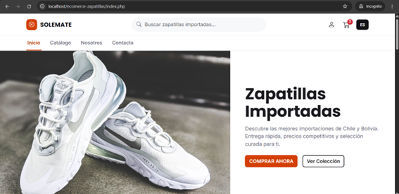
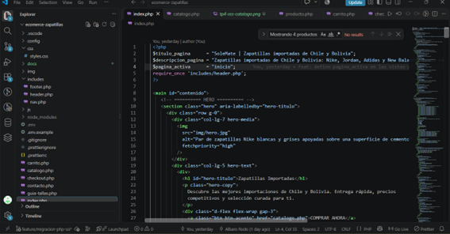
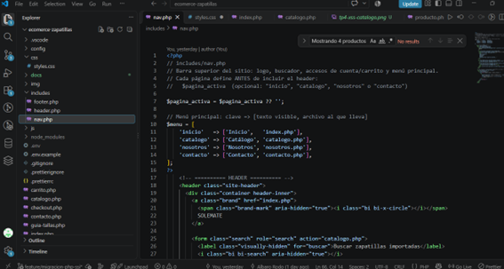
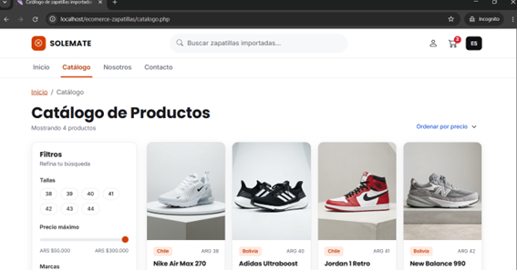
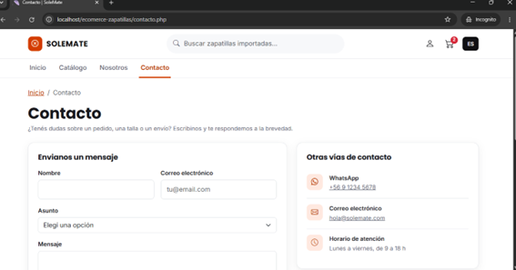
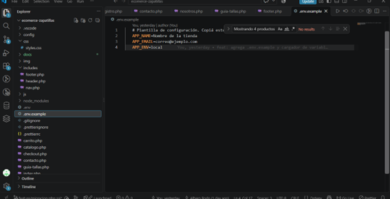
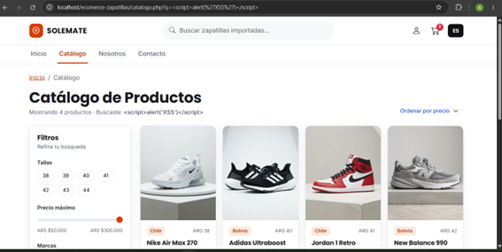

# SoleMate – Ecommerce de zapatillas importadas

Sitio web de **SoleMate**, una tienda online de zapatillas importadas de Chile y Bolivia (Nike, Jordan, Adidas y New Balance). Proyecto de la materia **Programación Web**, desarrollado en dos etapas:

- **TP N° 3:** maquetación front-end en HTML5 semántico, CSS3 y Bootstrap, con Git Workflow, SEO y accesibilidad.
- **TP N° 4:** _Migración a PHP, Modularización (SSI) y Renderizado Server-Side (SSR)_. Las 10 vistas pasaron de HTML estático a PHP, con plantillas reutilizables, título y menú dinámicos, y variables de entorno.

## Enlaces

- **Repositorio:** https://github.com/albarorodo1234-oss/ecommerce-zapatillas
- **Prototipo en Figma:** [Ver el prototipo](https://www.figma.com/proto/jUfOsxLjA2Qn9kg3WJqB8j/Ecomerce-Zapatillas?node-id=2-3&p=f&t=eQLWJaIzpomdRZIH-1&scaling=scale-down-width&content-scaling=fixed&page-id=0%3A1)
- **Informe de auditoría Lighthouse (TP N° 3):** [docs/auditoria-lighthouse.md](docs/auditoria-lighthouse.md)

> **Nota sobre la publicación:** en el TP N° 3 el sitio era HTML estático y se publicaba en GitHub Pages. Desde el TP N° 4 las vistas son `.php` y necesitan un servidor con PHP, que GitHub Pages no ofrece. Por eso el sitio se ejecuta en local con XAMPP (ver [Cómo ejecutarlo localmente](#cómo-ejecutarlo-localmente)).

## Refactorización a PHP (TP N° 4)

| Requisito                | Cómo se resolvió                                                                                                                                                                                                         |
| ------------------------ | ------------------------------------------------------------------------------------------------------------------------------------------------------------------------------------------------------------------------ |
| **Migración a PHP**      | Las 10 vistas `.html` se renombraron a `.php` con `git mv` (se conserva el historial) y se actualizaron todos los enlaces internos.                                                                                      |
| **Modularización (SSI)** | El código repetido se extrajo a `includes/`: `header.php` (`<head>`, metadatos y estilos), `nav.php` (barra superior y menú principal) y `footer.php` (pie de página y scripts). Cada vista los trae con `require_once`. |
| **SSR básico**           | Cada vista define `$titulo_pagina`, `$descripcion_pagina` y `$pagina_activa` antes de incluir el encabezado. El servidor arma el `<title>`, la descripción y la clase `active` del menú.                                 |
| **Variables de entorno** | El archivo `.env` (ignorado por Git) guarda `APP_NAME`, `APP_EMAIL` y `APP_ENV`. `config/env.php` las lee y las convierte en constantes. El repositorio incluye `.env.example` como plantilla.                           |
| **Seguridad (XSS)**      | Los datos que se imprimen se escapan con `htmlspecialchars()`. Por ejemplo, el término buscado en el catálogo.                                                                                                           |

### Cómo queda cada vista

```php
<?php
$titulo_pagina      = "Catálogo de zapatillas importadas | SoleMate";
$descripcion_pagina = "Explorá el catálogo de SoleMate: ...";
$pagina_activa      = "catalogo";
require_once 'includes/header.php';   // <head> + barra superior + menú
?>

<main id="contenido">
  <!-- contenido propio de la vista -->
</main>

<?php require_once 'includes/footer.php'; ?>
```

### Plantillas (`includes/`)

| Archivo               | Contenido                                                                              |
| --------------------- | -------------------------------------------------------------------------------------- |
| `includes/header.php` | Carga `config/env.php`, abre el HTML y el `<head>` y llama a `nav.php`                 |
| `includes/nav.php`    | Logo, buscador, accesos de cuenta y carrito, y el menú principal con la clase `active` |
| `includes/footer.php` | Pie de página, script `js/main.js` y cierre de `</body></html>`                        |

### Variables de entorno

`.env.example` (se sube al repositorio) muestra qué datos hay que configurar:

```
APP_NAME=Nombre de la tienda
APP_EMAIL=correo@ejemplo.com
APP_ENV=local
```

Para usarlas, se copia como `.env` y se completan los valores. El archivo `.env` real está en el `.gitignore` y **no se versiona**.

## Vistas del sitio

Las 10 vistas se maquetaron a partir del diseño hecho en Figma. La última columna indica qué enlace del menú principal se resalta en cada una.

| #   | Vista                | Archivo                            | Menú resaltado |
| --- | -------------------- | ---------------------------------- | -------------- |
| 1   | Inicio               | [index.php](index.php)             | Inicio         |
| 2   | Catálogo con filtros | [catalogo.php](catalogo.php)       | Catálogo       |
| 3   | Detalle de producto  | [producto.php](producto.php)       | Catálogo       |
| 4   | Carrito              | [carrito.php](carrito.php)         | –              |
| 5   | Inicio de sesión     | [login.php](login.php)             | –              |
| 6   | Registro             | [registro.php](registro.php)       | –              |
| 7   | Guía de tallas       | [guia-tallas.php](guia-tallas.php) | –              |
| 8   | Checkout             | [checkout.php](checkout.php)       | –              |
| 9   | Contacto             | [contacto.php](contacto.php)       | Contacto       |
| 10  | Nosotros             | [nosotros.php](nosotros.php)       | Nosotros       |

## Evidencia de funcionamiento (TP N° 4)

### Servidor local (XAMPP + Apache + PHP)



### Modularización con includes (SSI)

Estructura de la carpeta `includes/` y una vista que los trae con `require_once`:



Menú principal en `includes/nav.php`, con la clase `active` decidida por PHP:



### Navegación dinámica (SSR)

Cada vista muestra su propio título en la pestaña y resalta su sección en el menú. En el catálogo:



En contacto:



### Variables de entorno

El archivo `.env.example` está en el repositorio como plantilla; el `.env` real queda fuera de Git:



### Seguridad: prevención de XSS

Al buscar `<script>alert('XSS')</script>`, el catálogo muestra el texto tal cual, sin ejecutarlo, porque se imprime con `htmlspecialchars()`:



## Diseño en Figma


### Paleta y tipografías

| Uso                     | Color     |
| ----------------------- | --------- |
| Naranja vivo (detalles) | `#FF4D00` |
| Naranja de botones      | `#D43F00` |
| Rojo (contador)         | `#D62839` |
| Amarillo (estrellas)    | `#FFB400` |
| Oscuro (footer)         | `#111114` |
| Fondo suave             | `#F7F8FA` |

- **Títulos:** Poppins
- **Textos:** Inter

El naranja del diseño original (`#FF4D00`) no alcanza el contraste mínimo de 4,5:1 con texto blanco, por lo que en botones se usa `#D43F00`, casi idéntico a la vista y accesible.

## Tecnologías

- HTML5 semántico
- CSS3 con variables personalizadas
- [Bootstrap 5.3.3](https://getbootstrap.com/) y [Bootstrap Icons 1.11.3](https://icons.getbootstrap.com/)
- JavaScript (archivo base `js/main.js`)
- **PHP 8** (includes con `require_once`, variables, constantes y `htmlspecialchars()`)
- **XAMPP** (servidor Apache con PHP para desarrollo local)
- Variables de entorno con archivo `.env`
- Google Fonts (Poppins e Inter)
- Prettier (formateo de código)
- Lighthouse (auditoría de accesibilidad, buenas prácticas y SEO)
- Git y GitHub
- VSCode y Figma (diseño)

## Estructura del proyecto

```
ecommerce-zapatillas/
├── config/
│   └── env.php               # lee el archivo .env y define las constantes
├── includes/
│   ├── header.php            # <head>, metadatos y estilos
│   ├── nav.php               # barra superior y menú principal
│   └── footer.php            # pie de página y scripts
├── css/
│   └── styles.css
├── js/
│   └── main.js
├── img/                      # fotografías de productos y hero
├── docs/
│   ├── auditoria-lighthouse.md
│   ├── diseno/               # capturas del diseño de Figma
│   ├── lighthouse/           # capturas de la auditoría
│   └── tp4-*.png             # capturas del TP N° 4
├── .vscode/settings.json     # formateo con Prettier al guardar
├── .env.example              # plantilla de variables de entorno
├── .gitignore                # ignora .env y node_modules
├── .prettierrc
├── .prettierignore
├── index.php
├── catalogo.php
├── producto.php
├── carrito.php
├── login.php
├── registro.php
├── guia-tallas.php
├── checkout.php
├── contacto.php
├── nosotros.php
└── README.md
```

## Cómo ejecutarlo localmente

Las vistas son archivos PHP, por lo que **no se pueden abrir con doble clic ni con Live Server**: necesitan un servidor con PHP.

1. Instalar [XAMPP](https://www.apachefriends.org/) (con PHP 8.x).

2. Clonar el repositorio dentro de la carpeta `htdocs` de XAMPP:

   ```bash
   cd C:\xampp\htdocs
   git clone https://github.com/albarorodo1234-oss/ecommerce-zapatillas.git
   cd ecommerce-zapatillas
   ```

3. Crear el archivo `.env` a partir de la plantilla y completar los valores:

   ```bash
   copy .env.example .env      # Windows
   cp .env.example .env        # macOS / Linux
   ```

4. Abrir el **Panel de Control de XAMPP** y presionar **Start** en Apache.

5. Entrar en el navegador a:

   ```
   http://localhost/ecommerce-zapatillas/index.php
   ```

   (El nombre de la carpeta dentro de `htdocs` forma parte de la dirección.)

6. (Opcional) Instalar Prettier y verificar el formato:

   ```bash
   npm install
   npx prettier . --check
   ```

## Flujo de trabajo con Git

### TP N° 3

El proyecto se desarrolló con un flujo basado en ramas y Pull Request:

1. Se creó el repositorio y la estructura base (`css/`, `js/`, `img/`) sobre la rama `main`.
2. Se creó la rama de trabajo `feature/maquetacion`.
3. Se maquetaron las 10 vistas con commits frecuentes, uno por vista o bloque lógico.
4. Se formateó el código con Prettier y se auditó con Lighthouse.
5. Se subió la rama a GitHub y se abrió un Pull Request hacia `main`.
6. Se revisó y se fusionó (merge) el Pull Request.

### TP N° 4

1. Se creó la rama `feature/migracion-php-ssi` a partir de `main`.
2. Se agregó `.env` al `.gitignore` antes de crearlo, para que nunca llegue al repositorio.
3. Se hicieron **commits atómicos**: uno para renombrar las vistas, uno para las variables de entorno, uno para las plantillas, uno por cada vista refactorizada, y otros para el menú, la seguridad y la documentación.
4. Se subió la rama a GitHub y se abrió un Pull Request hacia `main`.

Los mensajes de commit siguen una convención de prefijos:

| Prefijo     | Uso                                           |
| ----------- | --------------------------------------------- |
| `feat:`     | Funcionalidad o vista nueva                   |
| `fix:`      | Corrección                                    |
| `refactor:` | Reorganización de código sin cambiar qué hace |
| `style:`    | Formato de código                             |
| `docs:`     | Documentación                                 |
| `chore:`    | Tareas de configuración                       |

## HTML semántico, SEO y accesibilidad

- Estructura con `header`, `nav`, `main`, `section`, `article`, `aside` y `footer`.
- Un solo `<h1>` por página y títulos en orden jerárquico.
- `<title>` y `meta description` propios en cada vista (generados por PHP desde `$titulo_pagina` y `$descripcion_pagina`), con `<html lang="es">`.
- Menú principal con `aria-current="page"` en el enlace de la sección actual.
- Texto alternativo (`alt`) descriptivo en las imágenes; vacío en las decorativas.
- Todos los campos de formulario con `<label>` asociado; opciones agrupadas con `<fieldset>` y `<legend>`.
- Enlace "Saltar al contenido" y estilos de foco visibles para navegar con teclado.
- `aria-label` en íconos enlazados y botones sin texto visible.
- Contraste de color de al menos 4,5:1 en los textos.
- Respeto de `prefers-reduced-motion`.
- Diseño responsive con la grilla de Bootstrap.
- Rutas relativas y nombres de archivo en minúsculas, para evitar problemas en servidores que distinguen mayúsculas.

## Seguridad

- Los datos que se imprimen en pantalla se escapan con `htmlspecialchars()`, para que el navegador los trate como texto y no como código (prevención de **XSS**). Se aplica al título y la descripción de cada vista, al nombre y correo tomados de `.env`, y al término buscado en el catálogo.
- El dato del buscador se valida antes de usarse: se comprueba que exista y sea texto, y se limpia con `trim()`.
- Las variables de entorno quedan fuera del repositorio gracias al `.gitignore`.

## Auditoría Lighthouse

Resultado de la home en el TP N° 3 (versión HTML estática, modo móvil, Lighthouse 13.5.0):

| Performance | Accessibility | Best Practices | SEO |
| ----------- | ------------- | -------------- | --- |
| 91          | 100           | 100            | 100 |


El detalle de las páginas auditadas, las medidas de accesibilidad aplicadas y las mejoras de rendimiento pendientes están en [docs/auditoria-lighthouse.md](docs/auditoria-lighthouse.md).

## Bootstrap vs. Tailwind CSS

| Criterio                 | Bootstrap                                                           | Tailwind CSS                                                                 |
| ------------------------ | ------------------------------------------------------------------- | ---------------------------------------------------------------------------- |
| Enfoque                  | Framework de **componentes** ya armados (navbar, card, botones)     | Framework de **utilidades**: clases pequeñas (`flex`, `p-4`) que se combinan |
| Curva de aprendizaje     | Baja: se copian y adaptan componentes                               | Media: hay que aprender su vocabulario de utilidades                         |
| Velocidad de prototipado | Muy rápida                                                          | Rápida una vez que se domina; más trabajo manual                             |
| Personalización          | Se sobrescribe con CSS propio; los sitios pueden parecerse entre sí | Diseño a medida desde cero, con más libertad                                 |
| HTML resultante          | Pocas clases por elemento (`btn btn-primary`)                       | Muchas clases por elemento                                                   |
| Peso del CSS             | Se carga el framework completo aunque se use una parte              | Genera solo las clases que se usan                                           |
| JavaScript               | Incluye componentes interactivos (modal, menú desplegable)          | No incluye JavaScript propio                                                 |
| Configuración            | Basta un `<link>` por CDN                                           | Requiere una herramienta de compilación para producción                      |

### Por qué se eligió Bootstrap

- Permitió maquetar **10 vistas** en poco tiempo gracias a su grilla (`row`, `col-*`) y a componentes listos: `card`, `breadcrumb`, `form-control`, `form-select`, `btn-check`, `table-responsive`.
- Tiene una curva de aprendizaje baja, ideal para un primer proyecto completo.
- Se integra con un solo `<link>`, sin herramientas de compilación.
- Los estilos propios (`css/styles.css`) se cargan después de Bootstrap y le dan al sitio una identidad visual propia (paleta, tipografías y componentes personalizados).

### Cuándo se elegiría Tailwind

Para un proyecto con un diseño muy particular, que no se parezca a ningún framework, o cuando se quiere un control fino del CSS y un resultado final más liviano.

## Mejoras futuras

- Procesar los formularios (contacto, login y registro) en PHP, con validación y saneamiento de los datos.
- Bloquear el acceso web al archivo `.env` (por ejemplo, con `.htaccess`) en un servidor real.
- Hacer funcional el sitio con JavaScript: carrito, filtros y ordenamiento de productos.
- Conectar con una base de datos para productos, usuarios y pedidos.
- Optimizar el peso de las imágenes para mejorar el rendimiento.
- Crear las páginas pendientes del footer (envíos, cambios y devoluciones, preguntas frecuentes).

## Datos académicos

Tecnicatura Superior en Análisis, Diseño y Desarrollo de Software – IES N° 6001, Salta, Argentina
Materia: Programación Web – TP N° 3 y TP N° 4
