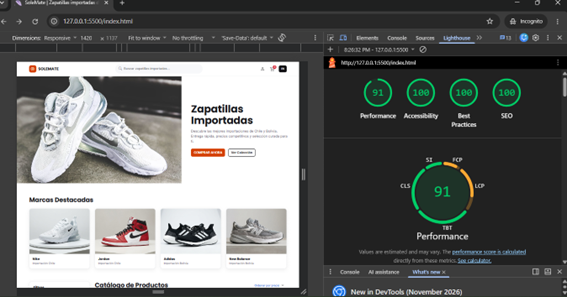
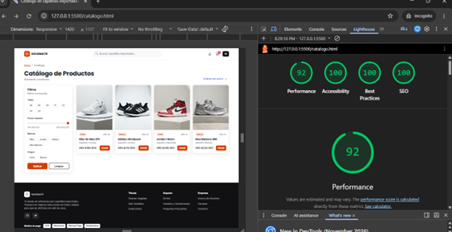
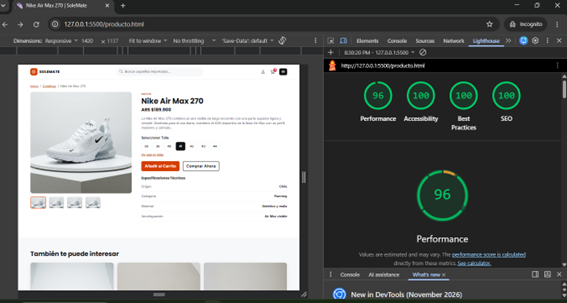
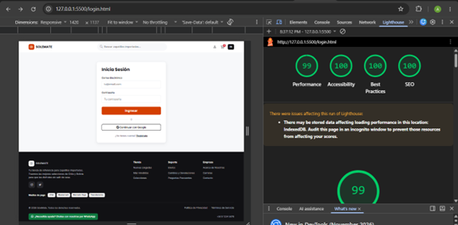
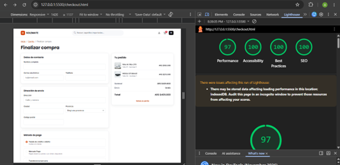

# Auditoría Lighthouse – SoleMate

## 1. Cómo se realizó

- **Herramienta:** Lighthouse 13.5.0 en Chrome DevTools.
- **Modo:** Navigation (carga inicial de la página).
- **Dispositivo:** Mobile (emulación de Moto G Power) con limitación de red Slow 4G.
- **Navegador:** Chrome en ventana de incógnito, para evitar que las extensiones alteren el resultado.
- **Entorno:** sitio local servido con Live Server (`127.0.0.1:5500`).
- **Fecha:** 4 de noviembre de 2026.
- **Páginas auditadas:** las 10 vistas del sitio.

## 2. Resultados iniciales

| Página   | Performance | Accessibility | Best Practices | SEO |
| -------- | ----------- | ------------- | -------------- | --- |
| index    | 91          | 100           | 100            | 100 |
| catalogo | 92          | 100           | 100            | 100 |
| producto | 96          | 100           | 100            | 100 |
| login    | 99          | 100           | 100            | 100 |
| checkout | 97          | 100           | 100            | 100 |

### Métricas de rendimiento de la home

| Métrica                        | Valor |
| ------------------------------ | ----- |
| First Contentful Paint (FCP)   | 1,9 s |
| Largest Contentful Paint (LCP) | 3,3 s |
| Total Blocking Time (TBT)      | 0 ms  |
| Cumulative Layout Shift (CLS)  | 0     |
| Speed Index                    | 1,9 s |

### Capturas

## 3. Fallas de accesibilidad detectadas y correcciones

La auditoría no detectó fallas de accesibilidad: todas las páginas auditadas obtuvieron 100 puntos en Accessibility. Esto se debe a que la accesibilidad se tuvo en cuenta desde la maquetación. Las medidas aplicadas fueron:

| #   | Medida                      | Detalle                                                                                                                        |
| --- | --------------------------- | ------------------------------------------------------------------------------------------------------------------------------ |
| 1   | Contraste de color          | El naranja del diseño (`#FF4D00`) no alcanzaba el contraste mínimo de 4,5:1 con texto blanco; en los botones se usó `#D43F00`. |
| 2   | Texto alternativo           | Todas las imágenes informativas tienen `alt` descriptivo; las decorativas usan `alt=""`.                                       |
| 3   | Formularios                 | Cada campo tiene su `<label for>` asociado; los grupos de opciones usan `<fieldset>` y `<legend>`.                             |
| 4   | HTML semántico              | Se usaron `header`, `nav`, `main`, `section`, `article`, `aside` y `footer`, con un solo `<h1>` por página y títulos en orden. |
| 5   | Navegación con teclado      | Se agregó el enlace "Saltar al contenido" y estilos de foco visibles (`:focus-visible`).                                       |
| 6   | Elementos sin texto visible | Los íconos enlazados (usuario, carrito, redes) y los botones `+`, `−` y "Eliminar" tienen `aria-label`.                        |
| 7   | Idioma y SEO básico         | `<html lang="es">`, `<title>` y `meta description` propios en cada página.                                                     |
| 8   | Movimiento reducido         | Se respeta `prefers-reduced-motion` para desactivar transiciones.                                                              |

## 4. Mejoras de rendimiento pendientes

Lighthouse sugirió estas optimizaciones. Son opcionales porque la home ya está en la zona verde (91), y los valores son estimaciones:

- Mejorar la entrega de imágenes (ahorro estimado de 301 KiB): comprimir y redimensionar las fotos, sobre todo la del hero.
- Reducir las solicitudes que bloquean el renderizado (ahorro estimado de 770 ms).
- Ajustar la visualización de fuentes (ahorro estimado de 160 ms).
- Reducir CSS sin usar (55 KiB) y minificar el CSS (6 KiB).

Cuando el sitio esté publicado en GitHub Pages se puede repetir la medición para obtener valores de rendimiento más representativos.

## 5. Resultados finales

Como no hubo fallas que corregir, los puntajes finales coinciden con los iniciales (ver sección 2).

## 6. Formato del código

El código se formateó con Prettier (`npx prettier . --check` sin diferencias) y se configuró VSCode para formatear al guardar.

## 7. Conclusiones

Pensar la accesibilidad desde el diseño (contraste, etiquetas, semántica y texto alternativo) evitó tener que corregir fallas después. La auditoría confirmó que el sitio cumple las buenas prácticas básicas de accesibilidad, buenas prácticas y SEO. El punto a mejorar es el peso de las imágenes, que se puede resolver comprimiéndolas.
