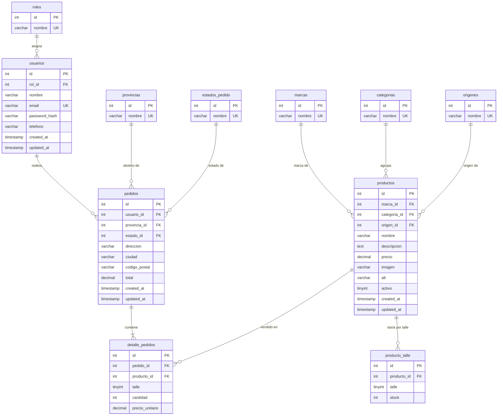

# TP N° 6 – Normalización de la base de datos de SoleMate

Parte 1 del Trabajo Práctico N° 6 (Programación Web): diseño del esquema relacional del e-commerce SoleMate aplicando las formas normales 1FN, 2FN y 3FN.

## 1. Tabla sin normalizar

Para el ejemplo se toma la entidad principal del negocio: el **pedido**. Si SoleMate registrara sus ventas en una única planilla, cada pedido sería una fila con todos los datos mezclados:

| id_pedido | fecha      | cliente         | email_cliente   | rol_cliente | direccion_envio                                 | provincia | productos                                                                                                                                       | estado    | total  |
| --------- | ---------- | --------------- | --------------- | ----------- | ----------------------------------------------- | --------- | ----------------------------------------------------------------------------------------------------------------------------------------------- | --------- | ------ |
| 1001      | 2026-11-10 | Lucía Fernández | lucia@mail.com  | Cliente     | Av. Belgrano 1250, Salta (CP 4400)              | Salta     | Nike Air Max 270 · Nike · Running · Chile · talle 38 · 1 u. · $189900; Jordan 1 Retro · Jordan · Basketball · Chile · talle 41 · 1 u. · $249900 | Pendiente | 439800 |
| 1002      | 2026-11-12 | Martín Gómez    | martin@mail.com | Cliente     | San Martín 455, San Miguel de Tucumán (CP 4000) | Tucumán   | Adidas Ultraboost · Adidas · Running · Bolivia · talle 40 · 2 u. · $219900                                                                      | Enviado   | 439800 |
| 1003      | 2026-11-15 | Lucía Fernández | lucia@mail.com  | Cliente     | Av. Belgrano 1250, Salta (CP 4400)              | Salta     | New Balance 990 · New Balance · Lifestyle · Bolivia · talle 42 · 1 u. · $229900                                                                 | Pendiente | 229900 |

### Problemas que presenta esta tabla

- **Campo multivalorado:** la columna `productos` guarda **una lista** de artículos en una sola celda (el pedido 1001 tiene dos zapatillas). No se puede consultar ni sumar cada producto por separado.
- **Campos no atómicos:** cada elemento de `productos` mezcla siete datos distintos (nombre, marca, categoría, origen, talle, cantidad y precio), y `direccion_envio` mezcla calle, ciudad y código postal.
- **Redundancia:** los datos de Lucía (nombre, email, rol y dirección) se repiten en los pedidos 1001 y 1003, y los datos de cada producto (marca, categoría y origen) se repetirían en cada pedido que lo incluya.
- **Anomalías que provoca:**
  - **De inserción:** no se puede registrar un producto nuevo del catálogo hasta que alguien lo compre.
  - **De actualización:** si Lucía cambia su email, hay que corregirlo en todas sus filas; si se olvida una, la base queda con datos contradictorios.
  - **De eliminación:** si se borra el pedido 1002, se pierde el único registro de que existe la Adidas Ultraboost y de que existe el cliente Martín.

## 2. Primera Forma Normal (1FN)

**Regla:** cada celda debe contener un único valor atómico, no puede haber grupos repetitivos y cada fila debe identificarse con una clave primaria.

**Cambios aplicados:**

- La lista de `productos` se separa en filas: el pedido 1001, que tenía dos zapatillas, ahora ocupa dos filas.
- Cada producto se divide en columnas atómicas: `producto`, `marca`, `categoria`, `origen`, `talle`, `cantidad` y `precio_unitario`.
- `direccion_envio` se divide en `direccion`, `ciudad` y `codigo_postal`.
- El nombre del cliente se mantiene como un solo campo (nombre completo), porque así lo solicita el formulario de registro del sitio.

| id_pedido | fecha      | cliente         | email_cliente   | rol_cliente | direccion         | ciudad                | codigo_postal | provincia | producto          | marca       | categoria  | origen  | talle | cantidad | precio_unitario | estado    | total  |
| --------- | ---------- | --------------- | --------------- | ----------- | ----------------- | --------------------- | ------------- | --------- | ----------------- | ----------- | ---------- | ------- | ----- | -------- | --------------- | --------- | ------ |
| 1001      | 2026-11-10 | Lucía Fernández | lucia@mail.com  | Cliente     | Av. Belgrano 1250 | Salta                 | 4400          | Salta     | Nike Air Max 270  | Nike        | Running    | Chile   | 38    | 1        | 189900          | Pendiente | 439800 |
| 1001      | 2026-11-10 | Lucía Fernández | lucia@mail.com  | Cliente     | Av. Belgrano 1250 | Salta                 | 4400          | Salta     | Jordan 1 Retro    | Jordan      | Basketball | Chile   | 41    | 1        | 249900          | Pendiente | 439800 |
| 1002      | 2026-11-12 | Martín Gómez    | martin@mail.com | Cliente     | San Martín 455    | San Miguel de Tucumán | 4000          | Tucumán   | Adidas Ultraboost | Adidas      | Running    | Bolivia | 40    | 2        | 219900          | Enviado   | 439800 |
| 1003      | 2026-11-15 | Lucía Fernández | lucia@mail.com  | Cliente     | Av. Belgrano 1250 | Salta                 | 4400          | Salta     | New Balance 990   | New Balance | Lifestyle  | Bolivia | 42    | 1        | 229900          | Pendiente | 229900 |

**Clave primaria compuesta:** (`id_pedido`, `producto`, `talle`). Se incluye el talle porque un mismo pedido podría contener la misma zapatilla en dos talles distintos.

**Problema que persiste:** la tabla ya es atómica, pero aumentó la redundancia. Los datos del pedido 1001 (fecha, cliente, dirección, estado y total) se repiten en sus dos filas, porque dependen solo de `id_pedido` y no de la clave completa. Esto se resuelve en la 2FN.

## 3. Segunda Forma Normal (2FN)

**Regla:** la tabla debe estar en 1FN y ninguna columna no clave puede depender solo de una parte de la clave primaria compuesta (sin dependencias parciales).

**Análisis de dependencias** sobre la clave (`id_pedido`, `producto`, `talle`):

| Columnas                                                                                                                   | Dependen de                                 | Tipo de dependencia |
| -------------------------------------------------------------------------------------------------------------------------- | ------------------------------------------- | ------------------- |
| `fecha`, `cliente`, `email_cliente`, `rol_cliente`, `direccion`, `ciudad`, `codigo_postal`, `provincia`, `estado`, `total` | solo `id_pedido`                            | Parcial             |
| `marca`, `categoria`, `origen`, precio de lista                                                                            | solo `producto`                             | Parcial             |
| `cantidad`, `precio_unitario`                                                                                              | la clave completa (pedido, producto, talle) | Total               |

Las dependencias parciales se eliminan separando la tabla en tres. Además, a cada producto se le asigna un identificador numérico (`id_producto`) en lugar de usar su nombre como clave, porque el nombre puede cambiar.

**Tabla `pedidos`** (PK: `id_pedido`)

| id_pedido | fecha      | cliente         | email_cliente   | rol_cliente | direccion         | ciudad                | codigo_postal | provincia | estado    | total  |
| --------- | ---------- | --------------- | --------------- | ----------- | ----------------- | --------------------- | ------------- | --------- | --------- | ------ |
| 1001      | 2026-11-10 | Lucía Fernández | lucia@mail.com  | Cliente     | Av. Belgrano 1250 | Salta                 | 4400          | Salta     | Pendiente | 439800 |
| 1002      | 2026-11-12 | Martín Gómez    | martin@mail.com | Cliente     | San Martín 455    | San Miguel de Tucumán | 4000          | Tucumán   | Enviado   | 439800 |
| 1003      | 2026-11-15 | Lucía Fernández | lucia@mail.com  | Cliente     | Av. Belgrano 1250 | Salta                 | 4400          | Salta     | Pendiente | 229900 |

**Tabla `productos`** (PK: `id_producto`)

| id_producto | nombre            | marca       | categoria  | origen  | precio |
| ----------- | ----------------- | ----------- | ---------- | ------- | ------ |
| 1           | Nike Air Max 270  | Nike        | Running    | Chile   | 189900 |
| 2           | Adidas Ultraboost | Adidas      | Running    | Bolivia | 219900 |
| 3           | Jordan 1 Retro    | Jordan      | Basketball | Chile   | 249900 |
| 4           | New Balance 990   | New Balance | Lifestyle  | Bolivia | 229900 |

**Tabla `detalle_pedidos`** (PK compuesta: `id_pedido` + `id_producto` + `talle`; FK: `id_pedido` → `pedidos`, `id_producto` → `productos`)

| id_pedido | id_producto | talle | cantidad | precio_unitario |
| --------- | ----------- | ----- | -------- | --------------- |
| 1001      | 1           | 38    | 1        | 189900          |
| 1001      | 3           | 41    | 1        | 249900          |
| 1002      | 2           | 40    | 2        | 219900          |
| 1003      | 4           | 42    | 1        | 229900          |

**Por qué hay dos precios:** `productos.precio` es el precio actual del catálogo y puede modificarse; `detalle_pedidos.precio_unitario` guarda el precio al que se vendió en ese pedido, para que un aumento posterior no altere los pedidos ya realizados.

**Sobre `total`:** se podría calcular sumando `cantidad × precio_unitario` del detalle, pero se conserva en `pedidos` para consultar rápidamente el historial de compras sin recalcularlo cada vez.

**Problemas que persisten:**

- En `pedidos`, los datos de Lucía (nombre, rol) se repiten en los pedidos 1001 y 1003, porque dependen de su email y no del número de pedido.
- En `pedidos`, la provincia y el estado se escriben como texto en cada fila, aunque solo pueden tomar valores de una lista fija (las provincias del checkout y los estados posibles de un pedido).
- En `productos`, los nombres de marcas, categorías y orígenes se repiten como texto ("Running", "Chile"…), con riesgo de errores de tipeo.

Estas dependencias transitivas se eliminan en la 3FN.

## 4. Tercera Forma Normal (3FN)

**Regla:** la tabla debe estar en 2FN y ninguna columna no clave puede depender de otra columna no clave (sin dependencias transitivas).

**Dependencia transitiva detectada:** en `pedidos`, `id_pedido → email_cliente → cliente, rol_cliente`. El nombre y el rol no dependen del pedido sino del cliente; por eso los datos de Lucía se repetían en los pedidos 1001 y 1003. Se extraen a la tabla `usuarios` y `pedidos` conserva solo la clave foránea `id_usuario`.

**Tablas maestras:** los datos de otras entidades que se repetían como texto (rol, provincia, estado, marca, categoría y origen) se extraen a sus propias tablas, y las tablas que los usaban guardan solo la clave foránea. Así cada valor se escribe una sola vez y no se pueden cargar valores inexistentes o mal escritos.

**Decisión de diseño:** la dirección de envío (`direccion`, `ciudad`, `codigo_postal`, `id_provincia`) se mantiene en `pedidos`, porque pertenece a cada compra: un mismo cliente puede enviar pedidos a distintas direcciones. La ciudad se conserva como texto porque en el checkout se escribe libremente.

**Tabla `roles`** (PK: `id_rol`)

| id_rol | nombre        |
| ------ | ------------- |
| 1      | Administrador |
| 2      | Cliente       |

**Tabla `usuarios`** (PK: `id_usuario`; FK: `id_rol` → `roles`)

| id_usuario | nombre          | email           | id_rol |
| ---------- | --------------- | --------------- | ------ |
| 1          | Lucía Fernández | lucia@mail.com  | 2      |
| 2          | Martín Gómez    | martin@mail.com | 2      |

**Tabla `provincias`** (PK: `id_provincia`)

| id_provincia | nombre  |
| ------------ | ------- |
| 1            | Salta   |
| 2            | Tucumán |

**Tabla `estados_pedido`** (PK: `id_estado`)

| id_estado | nombre    |
| --------- | --------- |
| 1         | Pendiente |
| 2         | Enviado   |

**Tabla `pedidos`** (PK: `id_pedido`; FK: `id_usuario` → `usuarios`, `id_provincia` → `provincias`, `id_estado` → `estados_pedido`)

| id_pedido | fecha      | id_usuario | direccion         | ciudad                | codigo_postal | id_provincia | id_estado | total  |
| --------- | ---------- | ---------- | ----------------- | --------------------- | ------------- | ------------ | --------- | ------ |
| 1001      | 2026-11-10 | 1          | Av. Belgrano 1250 | Salta                 | 4400          | 1            | 1         | 439800 |
| 1002      | 2026-11-12 | 2          | San Martín 455    | San Miguel de Tucumán | 4000          | 2            | 2         | 439800 |
| 1003      | 2026-11-15 | 1          | Av. Belgrano 1250 | Salta                 | 4400          | 1            | 1         | 229900 |

**Tabla `marcas`** (PK: `id_marca`)

| id_marca | nombre      |
| -------- | ----------- |
| 1        | Nike        |
| 2        | Adidas      |
| 3        | Jordan      |
| 4        | New Balance |

**Tabla `categorias`** (PK: `id_categoria`)

| id_categoria | nombre     |
| ------------ | ---------- |
| 1            | Running    |
| 2            | Basketball |
| 3            | Lifestyle  |

**Tabla `origenes`** (PK: `id_origen`)

| id_origen | nombre  |
| --------- | ------- |
| 1         | Chile   |
| 2         | Bolivia |

**Tabla `productos`** (PK: `id_producto`; FK: `id_marca` → `marcas`, `id_categoria` → `categorias`, `id_origen` → `origenes`)

| id_producto | nombre            | id_marca | id_categoria | id_origen | precio |
| ----------- | ----------------- | -------- | ------------ | --------- | ------ |
| 1           | Nike Air Max 270  | 1        | 1            | 1         | 189900 |
| 2           | Adidas Ultraboost | 2        | 1            | 2         | 219900 |
| 3           | Jordan 1 Retro    | 3        | 2            | 1         | 249900 |
| 4           | New Balance 990   | 4        | 3            | 2         | 229900 |

**Tabla `detalle_pedidos`:** no cambia respecto de la 2FN, porque `cantidad` y `precio_unitario` ya dependen solo de su clave completa.

**Resultado:** cada dato se guarda una sola vez. Si Lucía cambia su email, se modifica una única fila de `usuarios`; si se borra un pedido, los productos y los clientes siguen existiendo; y se pueden cargar productos nuevos aunque nadie los haya comprado todavía.

## 5. Tablas resultantes (PK y FK)

Esquema final de la base de datos `solemate_db`. Se siguen las convenciones de la cátedra: tablas y columnas en `snake_case`, clave primaria `id` en cada tabla y claves foráneas con el formato `nombre_tabla_id`.

| Tabla             | Tipo                                        | PK   | FK                                                                                                | Otras columnas                                                                                  |
| ----------------- | ------------------------------------------- | ---- | ------------------------------------------------------------------------------------------------- | ----------------------------------------------------------------------------------------------- |
| `roles`           | Maestra                                     | `id` | —                                                                                                 | `nombre` (único)                                                                                |
| `provincias`      | Maestra                                     | `id` | —                                                                                                 | `nombre` (único)                                                                                |
| `estados_pedido`  | Maestra                                     | `id` | —                                                                                                 | `nombre` (único)                                                                                |
| `marcas`          | Maestra                                     | `id` | —                                                                                                 | `nombre` (único)                                                                                |
| `categorias`      | Maestra                                     | `id` | —                                                                                                 | `nombre` (único)                                                                                |
| `origenes`        | Maestra                                     | `id` | —                                                                                                 | `nombre` (único)                                                                                |
| `usuarios`        | Usuarios (autenticación)                    | `id` | `rol_id` → `roles.id`                                                                             | `nombre`, `email` (único), `password_hash`, `telefono`, `created_at`, `updated_at`              |
| `productos`       | Principal de negocio                        | `id` | `marca_id` → `marcas.id`, `categoria_id` → `categorias.id`, `origen_id` → `origenes.id`           | `nombre`, `descripcion`, `precio`, `imagen`, `alt`, `activo`, `created_at`, `updated_at`        |
| `pedidos`         | Principal de negocio                        | `id` | `usuario_id` → `usuarios.id`, `provincia_id` → `provincias.id`, `estado_id` → `estados_pedido.id` | `direccion`, `ciudad`, `codigo_postal`, `total`, `created_at`, `updated_at`                     |
| `detalle_pedidos` | Relación N:M (pedidos ↔ productos)          | `id` | `pedido_id` → `pedidos.id`, `producto_id` → `productos.id`                                        | `talle`, `cantidad`, `precio_unitario`; combinación única (`pedido_id`, `producto_id`, `talle`) |
| `producto_talle`  | Relación (stock de cada producto por talle) | `id` | `producto_id` → `productos.id`                                                                    | `talle`, `stock`; combinación única (`producto_id`, `talle`)                                    |

**Notas de diseño:**

- **Claves primarias:** todas las tablas usan `id INT AUTO_INCREMENT PRIMARY KEY`. En las tablas de relación, la clave compuesta que surgió en la 2FN se conserva como restricción `UNIQUE`, para que no se repita la misma combinación.
- **Autenticación:** `usuarios.password_hash` guarda la contraseña cifrada (nunca en texto plano) y `email` es único, porque se usa para iniciar sesión.
- **Fecha del pedido:** se toma de `pedidos.created_at`, que MySQL completa automáticamente al crear el registro.
- **Talles:** se guardan como número en `detalle_pedidos` y `producto_talle`, sin tabla propia, porque un talle no tiene otros atributos.
- **Productos visibles:** `productos.activo` (1 = visible, 0 = oculto) permite retirar un producto del catálogo sin borrarlo.
- **Auditoría:** las tablas principales (`usuarios`, `productos` y `pedidos`) tienen `created_at` y `updated_at`.

**Relaciones:**

- `roles` 1:N `usuarios` · `usuarios` 1:N `pedidos` · `provincias` 1:N `pedidos` · `estados_pedido` 1:N `pedidos`
- `marcas` 1:N `productos` · `categorias` 1:N `productos` · `origenes` 1:N `productos`
- `pedidos` N:M `productos`, resuelta con la tabla `detalle_pedidos`
- `productos` 1:N `producto_talle`

### Diagrama entidad-relación

